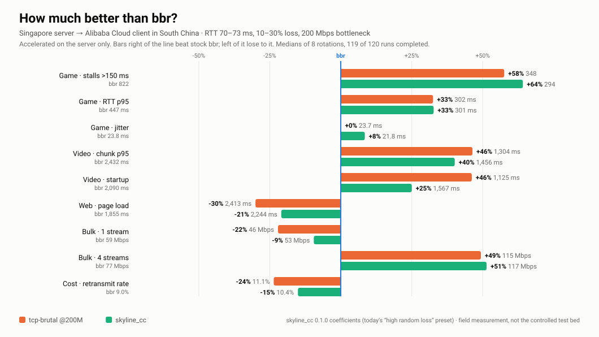

<div align="center">

# Skyline Speeder

**손실률이 높고 지연이 긴 회선을 위한 eBPF 기반 송신 측 TCP 가속**

*데이터를 보내는 서버에만 설치합니다. 클라이언트는 기본 TCP를 그대로 쓰며, 별도의 소프트웨어나 패치, 설정이 전혀 필요 없습니다.*

[](LICENSE)
[](#요구-사항)
[](install.sh)
[](bpf/)
[](rust-toolchain.toml)

[English](README.md) · [简体中文](README.zh.md) · [繁體中文](README.zh-TW.md) · [日本語](README.ja.md) · **한국어** · [Русский](README.ru.md) · [Français](README.fr.md)

---

### **[Skyline Connect](https://www.skylineconnect.io)** 단독 후원

---

</div>

## 소개

Skyline Speeder는 한쪽에만 설치하는 TCP 가속 소프트웨어입니다. 데이터를 보내는 서버에서 eBPF 프로그램으로 동작하며, 패킷 손실이 심하고 RTT가 길어서 표준 TCP의 성능이 급격히 무너지는 회선을 대상으로 합니다. 수신 측은 전혀 손대지 않습니다.

서버의 혼잡 제어를 `skyline_cc`로 교체하며, `skyline_cc`는 단 하나의 가정에서 출발합니다. **패킷 손실 자체에는 혼잡 정보가 담겨 있지 않다.**

- **측정한 뒤 보낸다:** 윈도우 크기는 측정한 대역폭 × 기준 RTT에 맞춰지며, 패킷이 유실되어도 줄어들지 않습니다.
- **보정하고 페이싱한다:** 측정한 손실률만큼 전송률을 높여 보정하되 상한을 두고, `fq`를 통해 일정한 간격으로 내보냅니다.
- **브레이크는 하나뿐:** 큐잉 지연이 늘어나거나 ECN 마킹이 들어올 때만 속도를 줄입니다.
- **짧은 응답 우선:** 연결마다 핸드셰이크와 첫 64 KiB를 10 ms 간격으로 두 번씩 보냅니다. 그래서 패킷 하나가 유실되어도 재전송 타이머를 기다리지 않고 몇 밀리초 지연으로 끝납니다.

> [!IMPORTANT]
> 손실이 큐와 무관하게 발생하는 경우에만 효과가 있습니다. 고정 속도 UDP 흐름에서는 손실이 없는데 TCP만 재전송이 많다면, 손실 원인은 혼잡한 병목 구간의 큐 넘침이며 이 도구로는 해결되지 않습니다.

## 요구 사항

- **Linux 6.12 LTS 이상**, `/sys/kernel/btf/vmlinux` 필요. 6.1·6.6 LTS 브랜치와 Debian 12, Ubuntu 22.04/24.04의 기본 커널은 버전이 너무 낮습니다.
- 물리 호스트 또는 KVM 가상 머신. 컨테이너(LXC, Proxmox CT)에서는 쓸 수 없습니다.
- Debian, Ubuntu, Fedora, RHEL 계열(Rocky Linux, AlmaLinux, CentOS Stream) 또는 Alpine.

## 빠른 시작

```bash
curl -fsSL https://raw.githubusercontent.com/CYBERVERSE-Research/skyline-speeder/main/scripts/bootstrap.sh | sudo bash
```

Alpine에서는 root로 실행합니다.

```sh
wget -qO- https://raw.githubusercontent.com/CYBERVERSE-Research/skyline-speeder/main/scripts/bootstrap.sh | sh
```

이 명령은 공개된 최신 릴리스를 설치하며, 호스트에 컴파일러를 설치하지 않습니다. 모든 BPF 오브젝트를 커널 검증기(verifier)로 검사한 뒤, 새로 맺어지는 모든 TCP 연결이 `skyline_cc`를 혼잡 제어로 쓰도록 설정하고 재부팅 후에도 이 설정을 유지합니다. 프록시를 설치하거나 포트를 열지는 않습니다. 설치가 끝나면 다음과 같이 확인합니다.

```bash
ssctl status    # 이 호스트에 적용됐는지 확인. ACCELERATING이면 적용됨
ssctl flows     # 가속 중인 연결과 알고리즘의 판단 내용
```

제거하려면 다음 명령을 실행합니다. 제거 후 호스트는 bbr + fq로 동작합니다.

```bash
curl -fsSL https://raw.githubusercontent.com/CYBERVERSE-Research/skyline-speeder/main/scripts/bootstrap.sh | sudo bash -s -- --uninstall
```

## 고급 사용법

**저장소를 클론해서 설치**하면 실행 전에 스크립트를 직접 검토할 수 있습니다.

```bash
git clone https://github.com/CYBERVERSE-Research/skyline-speeder.git
cd skyline-speeder
sudo ./install.sh --check      # 사전 점검만 수행, 시스템은 변경하지 않음
sudo ./install.sh              # 공개 릴리스 설치 (릴리스를 실행할 수 없는 환경에서만 빌드)
sudo ./install.sh --source     # 현재 소스 트리를 빌드해서 설치
sudo ./install.sh --release v0.6.0   # 지정한 공개 릴리스 설치, 불가능하면 중단
sudo ./install.sh --uninstall --restore-pre-install   # 제거 후 설치 전의 혼잡 제어와 qdisc로 되돌림
```

업그레이드할 때는 설치 스크립트를 다시 실행하면 됩니다. 진행 중인 흐름을 최대 60초 동안 드레인한 뒤 `skyline_cc`를 다시 적용합니다.

**일상 운영:**

```bash
sudo ssctl drain                                # 정상 분리(graceful detach): 새 연결은 fallback_cc 사용
sudo ssctl enable                               # 다시 적용
sudo ssctl enable --all-off                     # 모든 모듈을 끈 skyline_cc: 비교용 기준선
sudo ssctl set-redundancy --disable             # 첫 플라이트 중복 전송 끄기 (아웃바운드 트래픽 종량 과금 환경)
sudo ssctl set-module-config --max-pacing-mbps 500   # 전체 덮어쓰기: 지정하지 않은 플래그는 기본값으로 되돌아감
```

기본값은 튜닝을 거친 값이므로 대부분의 환경에서는 그대로 두면 됩니다. `ssctl set-*`로 바꾼 설정은 데몬이 재시작될 때까지만 유지되므로, 계속 쓰려면 `/etc/skyline-speeder/speeder.toml`에 반영하세요.

**문서**(영문):

| 문서 | 내용 |
|---|---|
| [docs/01-features.md](docs/01-features.md) | 설치 스크립트가 하는 일, 동작 원리, 기능별 기본값·비용·설정 스위치, `ssctl status`와 `ssctl flows` 출력의 줄별 설명, 소스 빌드 |
| [docs/usage.md](docs/usage.md) | 모든 스위치와 파라미터의 범위, 프리셋 4종, 문제 해결 |
| [DEPLOY.md](DEPLOY.md) | 배포·운영 매뉴얼: 설치, 검증, 업그레이드, 제거 |
| [docs/02-interface-reference.md](docs/02-interface-reference.md) | `ssctl` 명령, 통신 프로토콜, 설정 필드, 이벤트 코드 |
| [docs/03-design.md](docs/03-design.md) | 아키텍처와 모듈별 동작 방식 |
| [docs/04-performance-report.md](docs/04-performance-report.md) | 통제된 VM 2대 테스트베드에서 bbr과 비교한 결과 |

## 실측 성능

bbr, [tcp-brutal](https://github.com/HyNetworks/tcp-brutal), skyline_cc를 각각 서버 측에만 적용하고, 실제 국경 간 구간 한 곳에서 비교했습니다. 싱가포르의 KVM VPS에서 기본 TCP를 쓰는 중국 화남 지역의 Alibaba Cloud ECS(200 Mbps)로 전송했습니다. 측정 조건은 RTT 70-73 ms, 손실률 10-30%, 저녁 피크 시간대이며, 8 로테이션 × 3 알고리즘 × 5 시나리오로 진행했습니다.

<picture>
  <source media="(prefers-color-scheme: dark)" srcset="docs/images/single-ended-ataglance-dark.svg">
  
</picture>

| 시나리오 | 우세 | 차이 |
|---|---|---|
| **동영상** (6 MB 청크 @ 48 Mbps) | **tcp-brutal** | 재생 시작 시간 7/8 로테이션, 청크 p95 6/8 |
| **게임** (핑퐁, 초당 60개 메시지) | **skyline_cc** | 지터 5/8, 150 ms 초과 끊김 4/8 |
| **대용량, 4 스트림** | skyline_cc·tcp-brutal 모두 bbr보다 우세 | 중앙값 117 / 115 vs 77 Mbps |
| **대용량, 1 스트림** | bbr·skyline_cc 동률, tcp-brutal 최하위 | 중앙값 59 / 53 / 46 Mbps |
| **웹 페이지 로딩** | 뚜렷한 우세 없음 | 로테이션 간 편차가 알고리즘 간 차이보다 큼 |
| **서버 재전송** (전체 송신 세그먼트 대비 비율) | bbr이 가장 낮음 | bbr 9.1%, skyline_cc 10.4%, tcp-brutal 10.9% |

특정 구간 한 곳에서 얻은 현장 측정치일 뿐, 여러분의 회선에서도 같은 결과가 나온다는 뜻은 아닙니다. skyline_cc는 0.1.0 기본값(현재의 "high random loss" 프리셋)으로 실행했습니다. 측정 방법과 조건, 전체 결과는 [docs/01-features.md](docs/01-features.md#measured-performance-in-detail)에 있습니다.

## 라이선스

GPL-2.0 라이선스를 따릅니다. 자세한 내용은 [LICENSE](LICENSE)와 [NOTICE](NOTICE)를 참고하세요. Copyright (c) 2026 **CYBERVERSE LLC**. "Skyline Speeder"와 "CYBERVERSE"는 CYBERVERSE LLC의 상표입니다. 기여하기 전에 [CONTRIBUTING.md](CONTRIBUTING.md)를 읽어 주세요.

---

<div align="center">

**[Skyline Connect](https://www.skylineconnect.io)** 단독 후원

</div>
