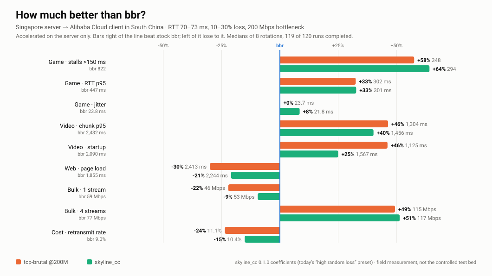

<div align="center">

# Skyline Speeder

**面向高丢包、高延迟链路的单边 TCP 加速，基于 eBPF**

*Sender-side TCP acceleration for high-loss, high-latency links, built on eBPF. Clients need no changes.*

[](LICENSE)
[](#内核版本要求)
[](install.sh)
[](bpf/)
[](rust-toolchain.toml)

**[English](README.md)** · 简体中文

---

### 由 **[Skyline Connect](https://www.skylineconnect.io)** 独家冠名

*Exclusively sponsored by [Skyline Connect](https://www.skylineconnect.io)*

---

</div>

## 这是什么

Skyline Speeder 是一套单边 TCP 加速软件：以 eBPF 程序的形式只运行在发送数据的服务器上，面向丢包严重、往返时延长、标准 TCP 在其上几乎跑不起来的链路。它的做法是让发送速率保持在这条路径实际能交付的水平，而不是每丢一个包就把速率砍下来，以此提高这类链路上的吞吐。接收端不做任何改动。

## 内核版本要求

**Linux 6.12 LTS 或更新**，且 `/sys/kernel/btf/vmlinux` 必须存在。`skyline_cc` 实现的是 4 参数的 `cong_control(sk, ack, flag, rs)` 回调，这个签名自 6.10 才有，更旧的内核会在加载时拒绝该程序。因此 6.1、6.6 两个 LTS 分支，以及 Debian 12 与 Ubuntu 22.04/24.04 的原装内核都不行。

已验证：`6.12.101`、`6.18.42`、`7.1.6` 通过（含 IPv4/IPv6 数据路径冒烟测试）；`6.1.180` 和 `6.6.148` 按设计加载失败。

**发行版：** Debian 与 Ubuntu（apt、systemd），Fedora 与 RHEL 系——Rocky Linux、AlmaLinux、CentOS Stream（dnf、systemd），以及 Alpine（apk、OpenRC），内核满足上面的要求即可。一键安装已在 Debian 13、Fedora 43、Rocky Linux 10.2 和 Alpine 3.23 上完整跑通。

## 快速开始

```bash
curl -fsSL https://raw.githubusercontent.com/CYBERVERSE-Research/skyline-speeder/main/scripts/bootstrap.sh | sudo bash
```

Alpine 上以 root 运行——全新的 Alpine 只有 `wget`，没有 `curl` 和 `bash`，引导脚本会把两者装上：

```sh
wget -qO- https://raw.githubusercontent.com/CYBERVERSE-Research/skyline-speeder/main/scripts/bootstrap.sh | sh
```

> [!NOTE]
> **一键安装现在默认安装最新发布的预编译版本**：直接使用预编译好的 BPF 对象和 daemon，不会在本机安装编译器、LLVM 或 Rust。v0.4.1 起每个 release 都带 glibc 版和给 Alpine 用的 musl 版两个产物。两个都跑不了时（不是 x86_64，或 glibc 低于 2.38，例如 Debian 12），安装器会说明原因并自动改为从源码构建。想强制从源码构建，或者安装指定版本：
>
> ```bash
> curl -fsSL https://raw.githubusercontent.com/CYBERVERSE-Research/skyline-speeder/main/scripts/bootstrap.sh | sudo bash -s -- --source           # 在本机从源码构建
> curl -fsSL https://raw.githubusercontent.com/CYBERVERSE-Research/skyline-speeder/main/scripts/bootstrap.sh | sudo bash -s -- --release v0.4.0   # 安装该版本，而不是最新版
> ```
>
> v0.4.0 及更早的安装器，不带参数时从源码构建，要装发布版得加 `--prebuilt`；一键安装运行的始终是 `main` 上的安装器，所以已经是新的默认行为。`--prebuilt` 仍然可用，现在的含义是"只装发布版"：本机跑不了发布版时直接停下，不会改为源码构建。

最小化的 Debian 镜像可能没有 `curl`（`apt-get install -y curl`），很多镜像也没有 `sudo`（已经是 root 就去掉）。想先看过脚本再运行（**推荐**，因为它会改变这台机器上所有新建连接的拥塞控制）：

```bash
git clone https://github.com/CYBERVERSE-Research/skyline-speeder.git
cd skyline-speeder
sudo ./install.sh              # 安装已发布的版本（本机跑不了时才从源码构建）
sudo ./install.sh --source     # 从这份源码构建
sudo ./install.sh --prebuilt   # 只装已发布的版本，装不了就停下
sudo ./install.sh --check      # 只做前置检查，不改动任何东西
sudo ./install.sh --no-enable  # 安装，但不挂载此前没挂载的 skyline_cc
sudo ./install.sh --verbose    # 不显示进度条，改为打印每条命令的输出
sudo ./install.sh --uninstall  # 卸载，把本机切回 bbr + fq，并卸掉安装时装上的包
                               #   （保留 /etc/skyline-speeder）
sudo ./install.sh --uninstall --restore-pre-install   # 同上，但还原成
                               #   安装前那台机器用的拥塞控制与 qdisc
```

安装器使用发行版自己的包管理器和服务管理器——apt、dnf 或 apk；systemd，Alpine 上是 OpenRC（本文档里的 `systemctl restart skyline-speederd` 在 Alpine 上对应 `rc-service skyline-speederd restart`）。它会检查内核，构建或下载三个 BPF 对象和 daemon，把 TC 程序指向默认路由所在的网卡（IPv4 或 IPv6；默认路由走 WireGuard 这类隧道时，它会请你自己指定网卡），让每个对象过一遍内核验证器，然后启动 daemon、挂载 `skyline_cc`，并把两者设为开机自启。安装过程中终端只显示一行进度，所有命令的输出都保存在 `/var/log/skyline-speeder-install.log`；装完会列出拥塞控制与 qdisc 改动前后的值，再给出 `ssctl` 用法、调参与卸载方法的简短指南。**不安装任何代理，不监听任何端口。**

`--uninstall` 会先 drain 掉存量连接，删除两个服务（systemd 单元，Alpine 上是 OpenRC 脚本）、二进制和 BPF 对象，把本机切到 **bbr + fq**，并卸掉安装时装上的包。装了哪些包是记录下来的（`/etc/skyline-speeder/added-packages`），也只卸这些：不碰 `iproute2`（Fedora/RHEL 上是 `iproute` 与 `iproute-tc`）、`curl`、`ca-certificates`、`tar`（Alpine 上还有 `bash`），不碰这几个包**仍然依赖**的东西（保留 `curl` 却删掉它底下的库，apt 根本做不到），也不碰 dpkg 标为 *required*/*important* 或 dnf 保护的包。卸之前先出计划（apt 自己出，dnf 用 `rpm -e --test`；apk 本来就不会删还被依赖的包）：计划里如果要连带删掉主机上别的东西，就把造成这件事的那个包单独留下并说明，其余照卸；只有在怎么缩减都无法得到一个不越界的计划时，才一个都不卸、改为打印手工命令。rustup 工具链只在确实是安装器装的情况下才移除。`bbr` 与 `fq` 只在本次运行时生效——不写也不改 `/etc/sysctl.d` 下的任何文件，所以重启后仍由那些文件决定。加 `--restore-pre-install` 则还原成安装前那台机器用的拥塞控制与 qdisc（包括出口网卡的根 qdisc，安装时一并记录）。两种方式都保留 `/etc/skyline-speeder`，重装时你的配置还在。

已发布的版本不需要编译工具链，只需要 `curl`、`tar` 和 `iproute2`（安装器会自动安装）：对象是 CO-RE 的，用固定的 6.12 参考头编译，加载时再按这台机器的内核重定位。预编译的 daemon 有两个构建：一个在 Ubuntu 24.04 上构建，需要 glibc 2.38 以上以及 `libelf.so.1`、`libz.so.1`（Debian 13、Ubuntu 24.04、Fedora 43、Rocky Linux 10 及更新版本满足）；另一个自 v0.4.1 起在 Alpine 3.21 里针对 musl 构建，Alpine 3.21 及更新会装它，外加 `libelf`、`zlib`、`zstd-libs`、`libgcc`。用户态更旧的系统，默认安装会自动改为从源码构建，`--source` 则在任何机器上都从源码构建。`--release <tag>` 指定版本；连不上 GitHub 的机器，把产物拷过去后用 `SKYLINE_ARTIFACT_URL=/path/to/tarball sudo -E ./install.sh --prebuilt` 安装。装上的是已发布的 release，可能比这份 README、也比 `main` 旧：`main` 上在最新 release 之后合并的改动，要等下一个 release 才会进入一键安装。装的 release 早于这里描述的某个功能时（例如 v0.2.0 这个 release 还没有 qdisc 守护），安装器会明确提示。

> [!IMPORTANT]
> **升级：** 再运行一次安装器即可。新对象通过内核验证器后，它会自己重启 `skyline-speederd`：先让现有连接排空（最多 60 秒），再重新挂载 `skyline_cc`；原先是手工 `ssctl enable` 挂载的主机也一样。用 `ssctl` 做的修改不会保留到重启之后。原先从源码构建的主机会换成已发布的版本，除非再次带上 `--source`——v0.4.1 起 Alpine 也是如此。详见 [DEPLOY.md](DEPLOY.md) 第 10 节。

日常操作：

```bash
ssctl status    # 这台机器被接管了吗？附加状态、全机默认拥塞控制、守护、内核能力
ssctl flows     # 在加速什么？被加速的连接、它们上面的参数、算法决策计数器
ssctl drain     # 优雅摘除：新连接改走 fallback_cc，再等存量连接结束
```

两份报告都是给人看的：在终端上带颜色和符号，被管道接走时两样都没有。要给脚本解析就加 `--json`，打印 daemon 的原始应答。每一行的含义见[看懂 `ssctl status` 与 `ssctl flows`](#看懂-ssctl-status-与-ssctl-flows)。

`ssctl flows` 逐条列出内核当前跑在 `skyline_cc` 上的 TCP 连接（已发字节最多的 50 条，其余只给出条数）——对端、RTT、拥塞窗口、pacing 速率、交付速率、已发字节以及其中的重传占比——下面接着是这些连接上生效中的系数，以及算法决策计数器。逐条数据是**内核自己的**，通过 `ss` 读回：skyline_cc 的逐流状态存在 socket storage 里，用户态无法遍历，但 cwnd、pacing 速率和 RTT 恰好就是它写进套接字的那几项。

通过 SSH 执行 `ssctl drain` 总会走到超时，因为你自己的会话就是一条 skyline_cc 连接。这无害：它在开始等待之前就已经让新连接改走 `fallback_cc`。

## 原理

在丢包随机、与排队无关的长距离链路上，一丢包就减速的拥塞控制会直接塌掉；靠估计带宽的 BBR 也会让步：丢包恢复时退回"包守恒"，超时后从 1 个包重来。Skyline Speeder 在发送端把拥塞控制换成用 eBPF（`struct_ops`）实现的 `skyline_cc`，只基于一个前提：**丢包本身不携带拥塞信息。**

- **先测量，再发送。** 每轮测出投递速率和基准 RTT，每个 ACK（含丢包恢复期间）都把窗口直接设为 `带宽 × 基准 RTT × 增益`，丢包不会让它缩小。
- **补偿并匀速发送。** 丢包率为 `p` 的路径只交付发出量的 `1 - p`，速率因此放大 `1 / (1 - p)`（有上限），经 `fq` 均匀发出，不成批倾泻。
- **两个阶段。** STARTUP 快速爬到路径带宽，带宽不再增长后由 CRUISE 保持。
- **唯一的刹车。** 只有排队时延上升和 ECN 标记算拥塞，任一出现即把这一轮的速率压到测得带宽以下。
- **照顾短响应。** 每条连接的握手和前 64 KiB 各发两份、相隔 10 ms，丢一个包只多等几毫秒而不必等重传计时器，代价是每条连接约多发 64 KiB。

Rust 编写的 `skyline-speederd` 加载 BPF 程序（都要过内核验证器）、在线调整系数，`ssctl` 是它的命令行。每个功能的默认值、代价和开关见[配置](#配置)，机制细节见 [docs/03-design.md](docs/03-design.md)。

> [!IMPORTANT]
> **这个前提只对与排队无关的丢包成立。** 如果链路的丢包其实是拥塞瓶颈上的排队溢出，丢包补偿与排队护栏会朝相反方向用力，只会更糟。简单判断：固定速率的 UDP 打流不丢包、TCP 却大量重传，说明丢包是自身突发造成的排队溢出，这时不该用本工具。它也不追求公平：不会刻意和竞争的流平分链路。

### 三者的设计差别

|  | bbr | tcp-brutal | Skyline Speeder |
|---|---|---|---|
| 控制结构 | 闭环，探测带宽 | **开环**：速率由你给定 | 闭环，自己估带宽 |
| 因丢包降速 | 间接 | 否 | 否 |
| 需要预知链路带宽 | 否 | **是** | 否 |
| 拥塞自保护 | 有 | 无 | 排队时延 + ECN 护栏 |
| 形态 | 内核内置 | 内核模块（DKMS） | eBPF CO-RE，过验证器 |
| 内核门槛 | 任意 | 5.10 | **6.12 LTS** |

如果你知道出口带宽、它基本固定、且内核较老，tcp-brutal 是更简单的答案。Skyline Speeder 适合带宽未知或会变、需要拥塞护栏与可观测性、且能跑 6.12+ 内核的场景。真正拥塞的瓶颈链路上，两者都不合适。

## 配置

随附的默认值就是调好的值，**绝大多数部署不需要改**。默认安装后运行的全部功能，以及各自在哪里开关：

| 功能 | 默认 | 作用 | 开关 |
|---|---|---|---|
| [skyline_cc 及其模块](#模块) | 开，全机所有新建的 TCP 连接 | 按测得的带宽设定窗口和 pacing | `ssctl enable`、`ssctl drain` |
| [系数](#系数) | 调好的值 | 增益、护栏、上限、起步行为 | `ssctl set-module-config` |
| [首轮冗余](#首轮冗余) | 开 | 每条连接的握手和前 64 KiB 发两份 | `ssctl set-redundancy` |
| [拥塞控制与 qdisc 守护](#拥塞控制与-qdisc-守护) | 开，每 5 秒检查 | 守住 skyline_cc 和 `fq` | `[guard]` |
| [动态 RTO 上下限](#动态-rto-上下限) | 关 | 给每条连接的重传超时设上下限 | `ssctl set-rack-rto` |
| [重传包 DSCP 标记](#重传包-dscp-标记) | 关 | 给重传包打标记，供上游网络区别对待 | `ssctl set-retransmit-dscp` |
| [全局丢包检测 sysctl](#全局丢包检测-sysctl) | 用主机自己的值 | daemon 启动时可以代为写入的三个 `net.ipv4` sysctl | `[rack_tuning]` |
| [事件日志](#事件日志) | 开，超过 8 MiB 轮转 | 模式切换、丢包事件、护栏触发各记一行 | `[runtime] events_max_mib` |

`ssctl set-*` 命令立即生效，保持到 daemon 重启为止；要长期生效，见[让修改重启后仍然生效](#让修改重启后仍然生效)。`ssctl status` 和 `ssctl flows` 每一行的含义见[本节末尾](#看懂-ssctl-status-与-ssctl-flows)。

### 模块

`skyline_cc` 由四个模块组成，默认全开，可单独开关；`ssctl status` 里显示为 M1-M4：

| 模块 | 作用 | 关掉之后 |
|---|---|---|
| `adaptive-cwnd`（M2） | 按测得的带宽设定窗口，加速主要靠它 | 窗口像内核自带的 TCP 一样随丢包增减 |
| `loss-classifier`（M3） | 丢包补偿：按测得的丢包率放大估计值，而不是退让 | 不做补偿 |
| `pacing`（M4） | 按目标速率均匀发送 | 用内核默认的 pacing 速率 |
| `early-loss`（M1） | 更早发现丢包（当前内核上只是观测计数） | 发出的数据没有任何不同 |

```bash
ssctl enable                                  # 全开（默认）
ssctl enable --modules adaptive-cwnd,pacing   # 只开指定模块
ssctl enable --all-off                        # 全关，作为对照基准
ssctl disable --module loss-classifier        # 只关一个，其余不变
```

不带 `--modules` 的 `ssctl enable` 沿用当前的模块集合，所以执行过 `--modules` 或 `--all-off` 之后，要把四个都写上才回到全开。四个全关时，`skyline_cc` 的表现与内核自带的 TCP 一致，可以当作对比测试的中性基准。

`ssctl enable` 是全机生效的：挂载成功后会写 `net.ipv4.tcp_congestion_control = skyline_cc`，这台机器上所有新建 TCP 连接都会用它，已经建立的连接保持原来的算法。它还会把 `fq` 设好、武装[守护](#拥塞控制与-qdisc-守护)、启动[首轮冗余](#首轮冗余)。`ssctl drain` 让新连接改走 `fallback_cc`，并停掉后两者。

### 系数

十七个参数可以用 `ssctl set-module-config` 在线调整，无需重启。已建立的连接各自在下一轮（约两个 RTT）换用新值，并用新值从头估计。`ssctl flows` 的 *PARAMETERS IN FORCE* 段落按用途分行显示它们：

| `ssctl flows` 里的行 | 参数及默认值 | 管什么 |
|---|---|---|
| pacing rate | `--cruise-pacing-gain 1.25` `--startup-gain 3.0` `--max-pacing-mbps 1200` | CRUISE 与 STARTUP 阶段的发送速率是测得带宽的几倍（STARTUP 的增益同时用于窗口），以及每条连接的速率上限（Mbit/s） |
| congestion window | `--initial-cwnd-packets 100` `--min-cwnd-packets 32` `--max-cwnd-packets 50000` `--cruise-inflight-gain 3.0` | 初始窗口（0 = 用内核自己的）、窗口的下限与上限（包数），以及 CRUISE 期间在途数据最多是带宽 × 基准 RTT 的几倍 |
| queue guardrail | `--max-queue-delay-ms 70` `--max-queue-delay-ratio 0.6` `--guardrail-gain 0.8` | 排队时延（平滑 RTT 超出基准 RTT 的部分）超过 70 ms 与 0.6 × 基准 RTT 中的较大者，或收到 ECN 标记，这一轮的增益就降为 0.8。设为 1.0 时护栏只取消加速，不会压到测得带宽以下 |
| loss compensation | `--loss-inflation-max-ratio 0.10` | 最多按多高的丢包率补偿（0-0.5）：速率 × 1 / (1 − p)，默认值下最多 × 1.11 |
| bandwidth estimate | `--bw-window-rtts 6` `--min-rtt-window-s 30` | 带宽取最近 6 轮里最高的交付速率，基准 RTT 取最近 30 秒里最低的 RTT |
| startup exit | `--startup-growth-ratio 0.20` `--startup-plateau-rtts 5` | 连续 5 个测到带宽的轮次增长都不到 20%，或护栏触发，STARTUP 就结束。测到带宽的轮次，指有交付速率样本进入估计的轮次；连接还没填满窗口就没有数据可发的轮次（比如长连接上的小响应）既不计数，也不让计数清零 |
| framework switches | `--disable-prr-pacing` `--disable-auto-pacing` | 只在 `adaptive-cwnd` 或 `pacing` 关掉时起作用，让那条路径的行为与内核自己的一致；保持开启即可 |

> [!CAUTION]
> `set-module-config` 是**全量覆盖**，不是增量修改：没写的参数都会被重置为命令行的内置默认值，而不是保持你配置文件里的值。先在 *PARAMETERS IN FORCE* 里看清当前值，把要保留的全部写上；`ssctl reset-module-config` 回到配置文件里的值。

[使用与调参指南](docs/usage.md) 给出每个参数的允许范围和四档现成配方，其中「高随机丢包档」（文中名为 high random loss）适用于确实有 10%-20% 随机丢包的链路。

### 首轮冗余

默认开启。在丢包多的长距离链路上，一个短响应的大部分时间花在等丢包恢复上，而不是在传输上。初始窗口装得下的响应一个 RTT 就能送达；丢一个段至少再多一个 RTT，丢的是最后一个段要多两三个 RTT（先是尾部丢包探测，再是重传计时器），丢了 SYN-ACK 要等固定的 1 秒。这些计时器归内核管，窗口再大也缩短不了。

所以 `skyline_tc` 在出口网卡上把每条连接的开头发两份：

- skyline_cc 启用期间本机发出的每个 SYN-ACK（SYN-ACK 还没有拥塞控制，所以这一项是全机的）；
- 本机用 skyline_cc 主动发起的每条连接的 SYN；
- skyline_cc 连接里起点落在前 64 KiB 内的每个数据段，重传的也算。

副本比原包晚 10 ms，由 `fq` 扣住再发：丢包往往成片发生，紧挨着发出的两个包常常一起丢。除非两份都丢，这一段里的丢包只多花 10 ms，而不是一个 RTT 或一个计时器。接收端的 TCP 会丢弃后到的那一份，客户端什么都不用装。

**代价：** 没有丢包时，每条连接约多发 64 KiB 外加一个握手包。不到 64 KiB 的响应整个发了两遍；大文件下载只为开头 64 KiB 左右付费（跨过边界的那个段会整个复制）。这一段里的重传也会复制，所以丢得越多多发得越多，每条连接没有固定上限。出口流量按量计费，或线路本身不丢包时，可以关掉。

```bash
sudo ssctl set-redundancy --first-kib 32 --delay-ms 5   # 全量覆盖：没写的参数取默认值（64 KiB、10 ms）
sudo ssctl set-redundancy --disable                     # 关闭
sudo ssctl reset-redundancy                             # 回到配置文件里的 [redundancy]
```

配置文件里对应 `[redundancy]` 段的 `enabled`、`first_kib`（1-1024）和 `delay_ms`（0-100，0 表示紧跟原包）。复制只在 skyline_cc 挂载期间进行：`ssctl enable` 启动它，`ssctl drain` 停掉它。它需要 `skyline_tc` 挂在以太网的 `tc_interface` 上；根 qdisc 不是 `fq` 时，副本会立即发出。

`ssctl flows` 里有两处显示它。*PARAMETERS IN FORCE* 里的 `first-flight copies` 说明它是否在运行：`handshake + first 64 KiB of each connection sent twice, the copy +10 ms`（运行中）、`configured, not running`（应该运行而没有：TC 程序没有加载，或者最近一次 `ssctl enable` 说明了原因）、`stopped by the drain`（drain 正在等 skyline_cc 的最后几条连接），或 `off`。*TC EGRESS* 里的 `first-flight copies` 说明 daemon 启动以来它花了多少：`52,113 sent, 58.2 MiB (9,870 handshakes)` 依次是副本个数（一个 GSO 包算一个）、这些副本的字节数，以及其中 SYN 和 SYN-ACK 的个数。末尾出现 `N could not be made` 表示有副本没做成，正常情况下不会出现。

### 拥塞控制与 qdisc 守护

skyline_cc 挂载期间开启。`ssctl enable` 设好三项，之后由 daemon 守住：`net.ipv4.tcp_congestion_control = skyline_cc`；`net.core.default_qdisc = fq`，即 pacing 依赖的 qdisc；出口网卡的根 qdisc 为 `fq`（VLAN、bond、网桥则是它下面的物理网卡）。在 `ssctl drain` 之前，daemon 每 5 秒检查一次，被别的东西改掉（例如"一键 BBR"脚本的 sysctl 文件被再次应用）就改回来，并逐条记日志（`journalctl -u skyline-speederd | grep guard:`）。刻意搭建的 qdisc（`htb`、`tbf`、`netem`、设了带宽的 `cake` 等）不会被动。

```toml
[guard]
interval_s = 5    # 0：只在 ssctl enable 时检查
qdisc = true      # false：qdisc 完全交给你，只守拥塞控制
```

`ssctl status` 的 *DRIFT GUARD* 段落显示它：`ARMED`，三项各自的当前值和被改回的次数，最近一次纠正，最近一次错误（保留到下一次出错为止，可能是很久以前的），以及刻意没动的东西（`note`）。

### 动态 RTO 上下限

默认关闭。ACK 没有按时回来时，TCP 在重传超时（RTO）之后重发，之后每再超时一次就把等待时间翻倍，最长到 120 秒。丢包随机时，下一次重发并不比上一次更难成功，等这么久的连接只是卡住了。`skyline_policy` 可以给每条连接的 RTO 设上下限：

- **下限。** 内核的最小 RTO 默认是 200 ms。这里按连接把它设成 RTT × `srtt_permille` / 1000，夹在 `floor_us` 与 `ceiling_us`（最多 200 ms）之间，攒够 `warmup_samples` 个 RTT 样本之后才下发。6.12 上可用。
- **上限。** 把退避后的 RTO 封顶在 `rto_max_normal_permille` / 1000 × 连接的 RTT，并夹在 1-120 秒之间。每个 RTT 样本都重新计算一次；显示出拥塞的样本（新的 ECN 标记，或平滑 RTT 超过最小值的 `rto_max_congestion_ratio_permille` / 1000 倍，默认 2 倍）改用 `rto_max_congested_permille`。设为 0 则不设上限。**需要 Linux 6.15 或更新**：6.12 不认这个 socket 选项，`ssctl flows --json` 里只有 `rack_rto.stats.rto_max_rejected` 在增长。

例如（`set-rack-rto` 同样是全量覆盖：没写的参数取默认值）：

```bash
sudo ssctl set-rack-rto --srtt-permille 1100 --floor-us 20000 --ceiling-us 200000 --warmup-samples 4 \
    --rto-max-normal-permille 3000 --rto-max-congested-permille 6000
sudo ssctl set-rack-rto --disable
```

对一条 RTT 为 120 ms 的连接，这组值设下的下限是 1.1 × 120 ms = 132 ms，上限是 3 × 120 ms = 360 ms，再抬到 1 秒的最小值；平滑 RTT 超过最小值的两倍之后，比如到了 250 ms，上限变为 6 × 250 ms = 1.5 秒。

用之前要知道三件事：

- 只有 `/sys/fs/cgroup/skyline-speeder`（`runtime.cgroup_path`）里的进程建立的连接才会经过 `skyline_policy`；进程不在其中**不会报任何错误**，只是 `ssctl flows` 里 *connections seen* 一直是 0——不论动态 RTO 开没开，这一行都在。用 `sudo /opt/skyline-speeder/infra/run-in-skyline-cgroup.sh <你的服务启动命令...>` 在该 cgroup 里启动服务；systemd 服务的做法见 [DEPLOY.md](DEPLOY.md) 第 7 节。`skyline_cc` 本身是全局的，不需要 cgroup。
- **daemon 每次启动时它都是关闭的**，不管配置里的 `[rack_rto]` 怎么写。每次启动之后都要执行 `ssctl reset-rack-rto`（下发配置文件里的 `[rack_rto]`）或 `ssctl set-rack-rto`。
- 它在任何拥塞控制下都起作用，`ssctl drain` 也不会停掉它。

`ssctl flows` 的 *PARAMETERS IN FORCE* 里显示 `dynamic RTO floor` 和 `dynamic RTO ceiling`，另有 *DYNAMIC RTO* 段落（关闭时是 *CGROUP POLICY*，只有 `connections seen` 一行）：`applied` 是设下下限的次数（后面依次是被内核拒绝、等待预热、与已设的值相同而跳过的次数），`connections seen` 是经过 `skyline_policy` 的连接数。`applied` 在增长（连接短到过不了预热期时是 `warmup` 在增长），才说明它真的在运行。

### 重传包 DSCP 标记

默认关闭。给从 `tc_interface` 发出的每个重传 TCP 段打上一个 DSCP 编码，让上游路由器可以区别对待重传包，例如让它们走一条更干净的路径——前提是你的网络有这样的策略。它对这块网卡上的所有 TCP 一致生效，不论用的是哪种拥塞控制，IPv4、IPv6 都支持，`ssctl drain` 也不会停掉它。

> [!WARNING]
> 随附的 `dscp_value = 0` 只是占位：DSCP 0 表示尽力而为，打上去等于没打。具体数值必须由网络方给出；填成别处已在用的值，流量可能被误分类甚至限速。

```bash
sudo ssctl set-retransmit-dscp --dscp-value <值>   # 1-63，向网络方要；这条命令同时打开标记
sudo ssctl set-retransmit-dscp --disable           # 关闭，不管配置文件怎么写
sudo ssctl reset-retransmit-dscp                   # 回到配置文件里的 [retransmit_dscp]：没有显式开启就是关闭
```

和动态 RTO 一样，配置文件里的 `[retransmit_dscp]` 不会在 daemon 启动时下发：每次启动之后都要执行 `ssctl reset-retransmit-dscp`。标记需要 `skyline_tc` 挂在以太网的 `tc_interface` 上；它是隧道设备时命令会失败，原因写在 `ssctl status` 的 *ATTENTION* 段落里。`ssctl flows` 在 *PARAMETERS IN FORCE* 里显示 `retransmit DSCP  codepoint N on every TCP retransmission`，在 *TC EGRESS* 里显示 `retransmits marked  N of M detected`：只有标记在运行时才统计重传，所以 `M` 应当随流量增长，`N` 应当与它相等。

### 全局丢包检测 sysctl

默认用主机自己的值。在配置里写上 `[rack_tuning]` 段，daemon 启动时就会写入 `net.ipv4.tcp_recovery`、`tcp_reordering` 和 `tcp_early_retrans`，也就是内核的丢包检测设置（RACK、乱序阈值、尾部丢包探测）；写入被拒绝时 daemon 不会启动。它们是全局的：对这台机器上所有 TCP 连接生效，不论用的是哪种拥塞控制。安装的配置里没有这一段。`ssctl status` 的 *GLOBAL SYSCTLS (M1 tier-1)* 段落列出这三项，daemon 不接管时标 `(host)`；对它接管的值，启动之后被别的东西改掉时会告警（重启 daemon 即重新写入）。

### 事件日志

默认开启。每条 skyline_cc 连接的模式切换、丢包事件、护栏触发、撤销降窗和配置切换都写进 `/run/skyline-speeder/events.jsonl`，每条一行 JSON，以 socket cookie 区分连接。`/run` 在内存里，所以文件超过 `[runtime]` 的 `events_max_mib`（8 MiB）后会轮转成 `events.jsonl.1`（覆盖上一个），所以最多占用约两倍；设为 0 关闭日志，改动需要重启 daemon。事件码见 [docs/02-interface-reference.md](docs/02-interface-reference.md) 第 8 节；护栏触发是 type 9，`ssctl flows` 在 *guardrail trips* 下面会注明。

### 让修改重启后仍然生效

`ssctl` 改的是 daemon 内存里的值，重启或升级之后就没了。要保留，写进 `/etc/skyline-speeder/speeder.toml`，字段名就是参数名把 `-` 换成 `_`：`max_*`、`initial_cwnd_packets`、`min_cwnd_packets`、`prr_pacing_enabled`、`auto_pacing_enabled` 在顶层，`loss_inflation_max_ratio` 在 `[loss_classifier]` 段，各种增益和带宽估计的设置在 `[adaptive_cwnd]` 段。然后校验并重启：

```bash
sudo skyline-speederd --config /etc/skyline-speeder/speeder.toml --validate-only
sudo systemctl restart skyline-speederd    # 挂载服务随之重新挂载 skyline_cc
```

0.5.0 起，拼错的键或写错段落的键会让 `--validate-only` 报错，并指出它该放在哪一段。`[rack_rto]` 和 `[retransmit_dscp]` 有两点不同：写进文件时还要加上 `enabled = true`（它们的 `set-*` 命令隐含了这一项），重启之后也只有 `ssctl reset-rack-rto` 和 `ssctl reset-retransmit-dscp` 才会下发它们。

### 看懂 `ssctl status` 与 `ssctl flows`

`ssctl status` 回答的是 *这台机器被接管了吗？*

| 行 | 含义 |
|---|---|
| 首行 | 正在运行的 daemon 的版本（升级后、daemon 重启之前，`ssctl --version` 可能与它不同）和结论：`ACCELERATING`，已挂载且是全机默认；`ATTACHED, NOT DEFAULT`，之后有东西改了默认算法，新连接绕开了 skyline_cc，执行 `ssctl enable`；`DRAINING`，一次 drain 已经把新连接交给 `fallback_cc`，skyline_cc 只服务它还剩的连接（通过 SSH 执行的 drain 总是停在这里；`ssctl enable` 把主机接管回来）；`STANDBY`，没有挂载，执行 `ssctl enable` |
| skyline_cc struct_ops | 是否已挂载，挂载了多久 |
| host default cc | `net.ipv4.tcp_congestion_control`：新连接用什么算法 |
| fallback on drain | `fallback_cc`：`ssctl drain` 之后新连接用什么算法；如果主机的 sysctl 文件在开机时指定了一个本内核有的算法，安装脚本就把它设为该算法——全新安装时如此，之后每次升级或重装也会重新设置，除非你自己改过它 |
| modules | M1-M4；打勾表示此刻正作用于流量，所以没挂载时一个都不打勾 |
| live connections | 此刻跑在 skyline_cc 上的连接数 |
| DRIFT GUARD | 见[拥塞控制与 qdisc 守护](#拥塞控制与-qdisc-守护) |
| KERNEL | 内核版本；`required` 一行必须全部打勾。`optional` 里的 `RACK reorder hook` 需要打过补丁的内核，灰色是正常的 |
| GLOBAL SYSCTLS | 见[全局丢包检测 sysctl](#全局丢包检测-sysctl) |
| DAEMON | 运行时长，以及配置代际号：模块、系数或 RTO 上下限每变一次就加一 |
| ATTENTION | 需要留意的事，有处理命令的会一并给出。普通内核上开着 `early-loss` 时，这里总会写 early-loss 只做观测：这是正常的，不用处理 |

`ssctl flows` 回答的是 *在加速什么？*

| 行 | 含义 |
|---|---|
| 首行 | `ACCELERATING`；`IDLE`，已挂载但还没有连接跑在 skyline_cc 上；`DRAINING`，drain 正在等下面列出的连接结束；`BYPASSED`，已挂载但不是全机默认；`NOT ACCELERATING`，没有挂载 |
| coverage | 这台机器的 TCP 连接里跑在 skyline_cc 上的比例 |
| volume | 列出的连接已发送和重传的字节数，取自内核自己的计数器 |
| 连接表 | 逐条连接：RTT、窗口（包数）、skyline_cc 设定的 pacing 速率、内核估计的交付速率、已发字节及其中的重传占比 |
| PARAMETERS IN FORCE | [系数](#系数)，然后是 RTO 上下限、DSCP 标记和首轮冗余的状态 |
| window | 下面的计数器从挂载时开始累计 |
| ack decisions | skyline_cc 处理过的 ACK 数 |
| loss events | 检测到丢包的 ACK，占 ack decisions 的比例 |
| guardrail trips | 因排队时延或 ECN 标记把增益降到 `guardrail_gain` 的轮数，占检查过的轮数的比例 |
| cwnd at the cap | 处理完之后窗口停在 `max_cwnd_packets` 的 ACK 数：这是上限在起作用，不是拥塞 |
| last 1m | 同样三项在最近一分钟里的值：用来判断是否仍在发生 |
| mode switches | STARTUP 与 CRUISE 之间的切换次数 |
| pacing updates | pacing 速率重新计算的次数 |
| delivery samples | 相互重叠的速率样本之和，用于比较两次测试；不是包数 |
| PRR adjustments | 只在不为 0 时出现；`adaptive-cwnd` 开着时出现它，就是值得报告的缺陷 |
| TC EGRESS | daemon 启动以来从 `tc_interface` 发出的全部流量，不论拥塞控制：`seen` 是包数、字节数和 GSO 包数；然后是 [`retransmits marked`](#重传包-dscp-标记) 和 [`first-flight copies`](#首轮冗余) |
| DYNAMIC RTO，关闭时是 CGROUP POLICY | 见[动态 RTO 上下限](#动态-rto-上下限)；`connections seen` 用来判断 cgroup 里有没有进程 |

要给脚本解析就加 `--json`，打印 daemon 的原始应答。`ssctl snapshot <文件>` 让 daemon 把其中的 `status` 部分写进一个普通文件（systemd 下写到 `/run/skyline-speeder/` 最稳妥），`ssctl validate` 对照内核校验 daemon 内存里的配置。

## 仓库结构

```
skyline-speeder/
├── install.sh                    一键安装（Debian/Ubuntu、Fedora/RHEL、Alpine）
├── scripts/bootstrap.sh          远程安装入口（curl | sudo bash，或 wget | sh）
├── Makefile                      make bpf、make check、make test
├── bpf/
│   ├── skyline_cc.bpf.c          struct_ops 拥塞控制，每个 ACK 执行
│   ├── skyline_policy.bpf.c      cgroup sockops：选择拥塞控制，动态 RTO 上下限
│   ├── skyline_tc.bpf.c          TC egress：统计、重传 DSCP 标记、首轮冗余
│   └── include/skyline_abi.h     BPF 与用户态共享的 ABI
├── crates/
│   ├── skyline-speederd/         常驻控制面
│   ├── ssctl/                    命令行
│   └── skyline-common/           共享 ABI 类型与配置解析
├── config/                       speeder-guest.toml（安装用模板）/ speeder.toml（开发用）
├── packaging/                    systemd 单元；openrc/ 是给 OpenRC 的同样两个服务
├── infra/                        安装辅助、cgroup 工具、双 VM 测试床
├── research/experiments/         测试 manifest、执行、分析与现场测量
├── docs/                         使用指南、接口参考、设计、性能报告
├── DEPLOY.md                     部署与运维手册，面向自动化 agent
└── CONTRIBUTING.md               改动不能破坏的不变量
```

## 从源码构建

`sudo ./install.sh --source` 会把下面这些一步做完并装好。手工构建：

```bash
sudo apt-get install -y build-essential pkg-config clang llvm \
    libbpf-dev libelf-dev zlib1g-dev bpftool
# Fedora / RHEL（RHEL 系的 libbpf-devel 在 CodeReady Builder 里：加 --enablerepo=crb）：
#   sudo dnf install gcc make pkgconf-pkg-config clang llvm libbpf-devel elfutils-libelf-devel zlib-devel bpftool
# Alpine（bpftool 在 community 仓库）：
#   apk add build-base pkgconf clang llvm libbpf-dev elfutils-dev zlib-dev linux-headers bpftool
curl --proto '=https' --tlsv1.2 -sSf https://sh.rustup.rs | sh -s -- -y

make bpf                          # 生成 vmlinux.h 并编译三个 CO-RE 对象
cargo build --workspace --release
make check PYTHON="$(command -v python3)"   # 脚本语法、实验框架的测试（Python 3.11+）、格式、cargo check；cargo test 用 `make test`

# 让每个对象过一遍内核验证器，不挂载任何东西
skyline-speederd --config config/speeder.toml --validate-only --verify-bpf
```

Debian 12 上跑 `bookworm-backports` 的 6.12 内核时，`libelf-dev` 也要取 backports 那一份：backports 的 `linux-headers` 会把 `libelf1` 带到 0.192，而 bookworm 的 `libelf-dev` 把 `libelf1` 钉在 0.188，两者装不到一起（该取哪个版本看 `apt-cache madison libelf-dev`）。`install.sh` 会自己算出这一点。

`make bpf` 默认从本机 `/sys/kernel/btf/vmlinux` 读取类型信息；要用别的内核的 BTF，用 `make VMLINUX_BTF=<路径> bpf`；已有生成好的头，用 `make PREBUILT_VMLINUX_H=<路径> bpf`。

## 文档

下面的文档都是英文的，只有 README 有中文版（本文件）。

| 文档 | 内容 |
|---|---|
| **[docs/usage.md](docs/usage.md)** | **新手向：每个开关和参数、现成配方、排障** |
| [DEPLOY.md](DEPLOY.md) | 部署与运维手册，面向自动化 agent、运维同样照它操作：前置条件、安装、验证门禁、升级、排障、卸载 |
| [docs/02-interface-reference.md](docs/02-interface-reference.md) | `ssctl` 命令、控制面线协议、配置字段、事件码 |
| [docs/03-design.md](docs/03-design.md) | 架构与各模块的实现原理 |
| [docs/04-performance-report.md](docs/04-performance-report.md) | 受控测试床：环境、与 bbr 对比的结果、局限性 |
| [research/experiments/README.md](research/experiments/README.md) | 复现性能测试 |

## 实测性能

bbr、[tcp-brutal](https://github.com/HyNetworks/tcp-brutal) 与 skyline_cc 在一条真实跨境链路上的对比，三者都只部署在服务端，通过同一套按目的地前缀的路由覆盖生效，客户端全程使用原生 TCP。

| | 位置 | 角色 |
|---|---|---|
| **服务端** | **新加坡** KVM VPS · 10 Gbps | 发送方，唯一被加速的一端 |
| **客户端** | **阿里云** ECS，**华南（广东）** · 200 Mbps | 接收方，原生 TCP，不做任何改动 |

RTT 70-73 ms、丢包 10%-30%，测于晚高峰。skyline_cc 使用 0.1.0 时随附的默认系数，即现在 [使用与调参指南](docs/usage.md) 里的「高随机丢包档」；**当前的默认系数没有在这条链路上测过**。tcp-brutal 为 v2.0.0，速率 200 Mbps；bbr 为内核自带版本。

<picture>
  <source media="(prefers-color-scheme: dark)" srcset="docs/images/single-ended-ataglance-dark.svg">
  
</picture>

8 轮 × 3 算法 × 5 场景 = 120 次运行，119 次完成。每轮轮换算法顺序，避免链路在测试中劣化时偏袒先跑的那个。各场景赢家按轮统计：

| 场景 | 赢家 | 幅度 |
|---|---|---|
| **视频**（6 MB 分块 @ 48 Mbps） | **tcp-brutal** | 启动延迟赢 7/8 轮，分块 p95 赢 6/8 轮 |
| **游戏**（ping-pong，60 msg/s） | **skyline_cc** | 抖动 5/8 轮，卡顿 >150 ms 4/8 轮 |
| **大文件 · 4 并发** | skyline_cc 与 tcp-brutal，都领先 bbr | 中位数 117 / 115 vs 77 Mbps |
| **大文件 · 单流** | bbr 与 skyline_cc 打平，tcp-brutal 垫底 | 4/8、4/8、0/8 轮；中位数 59 / 53 / 46 Mbps |
| **网页加载** | 无稳定赢家 | 逐轮波动大于三者差异 |
| **服务端重传占比**（占全部发出的报文段，全部场景累计） | bbr 最低 | bbr 9.1%、skyline_cc 10.4%、tcp-brutal 10.9% |

最能说明三种设计差别的是单流结果。**tcp-brutal 发得最多、传得最少：它发出的报文段有 12.2% 是重传，bbr 为 9.0%，skyline_cc 为 10.0%，而它的中位吞吐只有 46 Mbps。** 在 10%-30% 丢包下，它固定的 200 Mbps 远高于这条路径能交付的速率，而"丢了就多发"的开环控制把这个差距全部变成了重传。skyline_cc 自己估计速率，没有一个会被设得过高的目标速率。

> [!NOTE]
> 这是一条链路上的现场测量，不是本仓库正式结论所依据的受控双 VM 测试床，也不代表你的链路。它 70 ms 的 RTT 还低于本项目 100-300 ms 的目标区间，在这个 RTT 下 bbr 从丢包中恢复要容易得多。请把它当作三种算法行为特点的证据，而不是吞吐量跑分。逐轮数据与原始记录见 [research/experiments/single-ended/](research/experiments/single-ended/)；受控测试床结果见 [性能验证报告](docs/04-performance-report.md)。

## 参与贡献

请先读 [CONTRIBUTING.md](CONTRIBUTING.md)。本项目有几条硬性不变量：两侧必须逐字节一致的 ABI 结构体、必须短于 16 字节的注册名、与 socket 路径耦合的 systemd `RuntimeDirectory`，以及三个完全不报错的失效点。内核验证器是硬门禁：加载不了的改动不算改动。

## 许可

版权所有 (c) 2026 **CYBERVERSE LLC**，以 **GPL-2.0** 分发，详见 [LICENSE](LICENSE)。

GPL-2.0 不是偏好选择：`skyline_cc.bpf.c` 中有若干段是对 GPL-2.0 Linux 内核算法的
高度贴近的重新实现（源码里逐处标了文件与行号），且三个 BPF 对象都向内核声明了
`GPL`。完整理由与上游归属见 [NOTICE](NOTICE)。

"Skyline Speeder"、"CYBERVERSE" 是 CYBERVERSE LLC 的商标；GPL 对代码的授权不包含
任何商标使用权。

---

<div align="center">

**[Skyline Connect](https://www.skylineconnect.io)** 独家冠名

</div>
