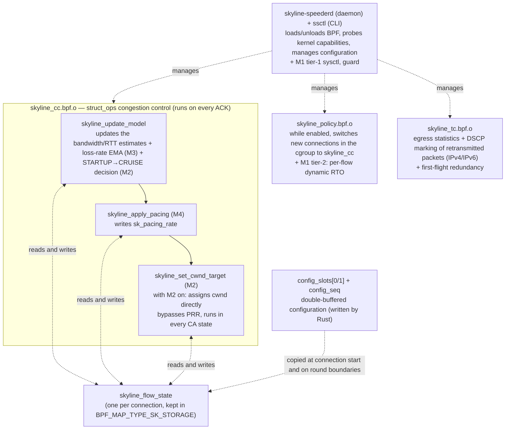
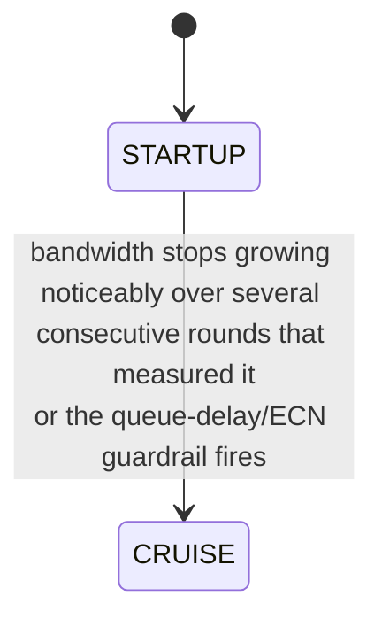

# Skyline Speeder Module Design

This document is for engineers who maintain or improve Skyline Speeder. It describes the current design in full: the
overall architecture, the mechanism of each module, the data flow between modules, and how the control plane is
implemented.

## 1. Design goals and orientation

Skyline Speeder is deployed only on the TCP **sender**. It needs no change to the client and no change to protocol
headers, and it is fully transparent to standard clients. The deployment environment it is designed for: a loss rate
of 10%-20% (independent random per-packet loss, not loss caused by queueing congestion), an RTT of 100-300ms, and
bandwidth from tens to hundreds of Mbps.

**Optimization target**: the goal is the single flow's own throughput/completion time; it does not aim to share
bandwidth fairly with other flows. This runs opposite to what standard CUBIC was designed for (the general Internet,
with an implicit fairness assumption) -- CUBIC treats any loss as a congestion signal, and in a high-random-loss
environment it pushes bandwidth utilization close to zero.

**Loss semantics**: Skyline Speeder recognizes only two real congestion signals -- growing queueing delay and ECN
marks. Loss itself is assumed by default to carry no congestion information, and it triggers no window cut at all.

**The invariant kept**: with all four optional modules turned off, Skyline Speeder must behave approximately like the
kernel's native CUBIC -- this is a **correctness** invariant (it verifies that the "modules off" path has no
unintended side effects), not a fairness requirement, and the two do not conflict.

## 2. Overall architecture

Skyline Speeder consists of 3 independent BPF objects + 1 piece of shared per-connection state + 1 Rust user-space
control plane:



Key points:

- M2 (adaptive cwnd)/M3 (loss-rate compensation)/M4 (pacing) are sections of code run in sequence inside the same
  struct_ops callback (`skyline_cong_control`, triggered on every ACK). They cooperate by reading and writing the same
  `skyline_flow_state`; they are not three independent programs that call each other.
- M1 (early loss awareness) lives in `skyline_policy.bpf.c`. It shares the same cgroup sockops attach point with
  "choosing the congestion control algorithm", but its logic is entirely separate.
- Whether each module takes effect is controlled by one bit mask in the configuration, `feature_mask` -- not four
  different pieces of code but conditional branches in the same code (see the bit definitions in
  `docs/02-interface-reference.md` section 7).

What each of the `bpf/`/`crates/`/`infra/`/`config/` directories is responsible for is in the README's "Repository
layout" section and in the comments at the top of the sources; the interfaces are in
`docs/02-interface-reference.md`; this document covers only the mechanisms themselves.

IPv4/IPv6 dual stack: the control plane (the Rust side) has no notion of addresses at all -- it knows only interface
names, Unix sockets and system sysctl paths -- so dual stack needs no change there; `skyline_cc` (M2/M3/M4) touches
only the address-family-independent fields of `tcp_sock`/`sock`, and needs no change either. The changes are in two
places: retransmission detection in `skyline_tc.bpf.c` gained a branch that walks IPv6 extension headers (a bounded
unroll; a fragment header, an authentication header or an unknown extension header is always passed through
untouched), and the family check in `skyline_policy.bpf.c` accepts both `AF_INET`/`AF_INET6` (including IPv4-mapped
addresses; see the dual-stack listening pitfall in `DEPLOY.md` section 13.5).

## 3. Shared state: `skyline_flow_state`

Defined in `bpf/include/skyline_abi.h` and kept in a map of type `BPF_MAP_TYPE_SK_STORAGE` -- this is **per-socket**
storage, allocated automatically when a connection is created and freed automatically when it is destroyed. "Shared"
means "shared among M2/M3/M4 within the same connection", not "one piece of data shared by all connections".

The fields fall into six categories:

| Category | Representative fields | Consumers |
|---|---|---|
| Congestion/bandwidth estimates | `min_rtt_us`/`min_srtt_us`/`bw_bps`/`bw_samples[10]`/`next_round_delivered` | The underlying estimators shared by all modules |
| State machine state | `mode` (STARTUP/CRUISE), `plateau_rounds`, `queue_clamped` | M2 |
| Loss-rate signal | `loss_rate_permille`, `last_lost`, `last_loss_rate_delivered` | Consumed by M3; the computation itself is independent of `feature_mask` |
| CUBIC growth core state (M2-off path only) | `w_max`, `epoch_start_ns`, `epoch_k_ms`, `tcp_cwnd`, `ack_cnt` | The framework layer's CUBIC growth core + the window cut when M2 is off |
| PRR state (M2-off path only) | `prior_cwnd`, `prr_delivered`, `recovery_active` (the amount already sent is read from the kernel's `tp->prr_out`) | The framework layer's PRR implementation; bypassed entirely when M2 is on |
| Configuration copy | `config`, `config_seq` | Every coefficient this connection reads comes from this copy, which is updated only at connection start and on round boundaries (section 11) |

The underlying estimators, updated continuously whatever the module switches: `min_rtt_us` (the lowest RTT seen; once
it has gone `min_rtt_window_s` without being refreshed, a larger new value may be accepted, so it does not cling to an
old value after the path changes), `bw_bps` (the peak delivery rate over the most recent `bw_window_rtts` rounds in
which a sample entered the filter, using only samples not limited by the application; besides the kernel marking
"application-limited" when the application writes, `skyline_cc` also adds the mark on every ACK, see "Bandwidth
estimate" in section 6), `next_round_delivered` (a round ends at the ACK that acknowledges a packet sent only after the
`delivered + packets_out` at the round's start had all been delivered -- first the data in flight at that moment is
delivered, then a packet sent after that is acknowledged, so for a flow with a full window a round is about two RTTs,
longer with SACK holes; the first round after the start or after a configuration switch is about one RTT; a BBR round
is about one RTT), `loss_rate_permille` (the flow's own measured loss rate, an exponential moving average,
alpha=1/4).

## 4. The neutral baseline: the framework layer with all modules off

With M1-M4 all turned off (`enabled_modules=[]`), Skyline Speeder aims to behave approximately like the kernel's native
CUBIC, not to "run any old way". This baseline is what makes the later question "how much does turning on a given
module gain" meaningful.

With M2 on, `skyline_cong_control()` takes direct charge of cwnd and never goes through the PRR/CUBIC growth core
here. The three framework-level implementations below run only when the corresponding module is off: the PRR
reimplementation and the CUBIC growth core when M2 is off, auto-pacing when M4 is off (whether or not M2 is on):

**PRR reimplementation** (`prr_pacing_enabled`, on by default): Skyline Speeder uses the `cong_control` struct_ops
callback, so the kernel skips its own PRR recovery-period rate limiting entirely. Skyline Speeder reimplements an
equivalent per-ACK limit itself (`skyline_apply_prr()`), which limits how much is sent on every ACK throughout the
recovery period instead of cutting the window once at the start of recovery -- otherwise cwnd would drop but the
sending pace would be uncontrolled, and the reduced cwnd could be filled within one RTT. As in the kernel, it runs
only in CWR and Recovery; the amount already sent is taken from the kernel's own `tp->prr_out` (the kernel maintains it
for every congestion control), and the one extra packet PRR-SSRB allows is given only when this ACK advanced
`snd_una`. In Loss, the growth path below slow-starts back up from the window `tcp_enter_loss()` left (before 0.5.2,
Loss also went through PRR, with the counts carried over from the previous recovery).

**Auto-pacing** (`auto_pacing_enabled`, on by default): with M4 off, the pacing rate is an equivalent capped rate
computed by the kernel's own formula (two ratios, one for the slow-start phase and one for the congestion-avoidance
phase), so that "M4 off" matches "the kernel's native pacing behaviour". With auto-pacing off as well, no pacing rate
is set: every ACK puts it back to the socket's own ceiling (`sk_max_pacing_rate`, which means unlimited when the
application has not set `SO_MAX_PACING_RATE`). The kernel does not update the pacing rate for an algorithm with
`cong_control` (it skips `tcp_update_pacing_rate()`), so the value computed from an initial window of 10 when the
handshake completes stays in place; before 0.5.2 that is exactly the value every ACK put back, and under `fq` it held
back the whole connection (about 5.7 Mbit/s at 40 ms on the lab network).

**CUBIC growth core** (the cwnd growth path when M2 is off): a full replica of kernel CUBIC's cubic growth formula
(`K` is computed once at the start of each growth epoch and frozen), the near-freeze branch for when "the curve has
not yet caught up with the current cwnd", and a separately maintained Reno-style growth floor (the TCP-friendliness
floor, which keeps growth from tending to 0 for long stretches under very short congestion epochs). As in
`bictcp_cong_avoid()`, the window does not grow when it is not the limiting factor (`tcp_is_cwnd_limited()`), and it
grows by at most one for every two segments acknowledged (since 0.5.2; before that, application-limited flows grew all
the same, and when the Reno floor was far ahead every acknowledgement could add one).

Together these three guarantee that, whatever the combination of M1-M4 switches, as long as M2/M4 are off, cwnd
growth and pacing behaviour match the kernel's native implementation exactly.

**Sending again after idle (`CA_EVENT_TX_START`)**: on the first send after a connection has been idle (no packets in
flight), the CUBIC growth core sets the start of the growth epoch, `epoch_start_ns`, to the current time. This event
used to arrive through `cwnd_event`; from Linux 7.1 the kernel hands it to `cwnd_event_tx_start`, newly added to
`tcp_congestion_ops`, and `cwnd_event` no longer sees it. `skyline_cc.bpf.o` therefore carries two struct_ops maps:
`skyline_cc` (the layout without this member) and `skyline_cc_txs` (with it). Both set the same callbacks and differ
only in where TX_START arrives. If a map sets a member the kernel does not know, libbpf rejects the whole map, so the
two cannot be merged into one; the daemon creates only one of them, by the running kernel's BTF
(`load_cc_object()`), and both register the algorithm name `skyline_cc`.

**Verification** (two-VM test bed, `research/experiments/manifests/neutrality.toml`, `n=2`, medians, in Mbit/s; the
same build as the main data in `docs/04-performance-report.md` -- kernel 6.18.40, first 12 hex digits of the
`skyline_cc.bpf.o` SHA-256 `1cb1d581c4f7`, see that report's Appendix A):

| Scenario | `b1-controlled-cubic` (kernel CUBIC + `fq`) | `b2-skyline-base` (all modules off) | `skyline-best` (all modules on) |
|---|---:|---:|---:|
| `dc-lowrtt` (RTT 2ms, 1000 Mbit/s, 0% loss) | 956.41 | 956.39 | 956.41 |
| `line-rate` (RTT 20ms, 1000 Mbit/s, 0% loss) | 956.41 | 956.41 | 956.40 |

In both zero-loss scenarios the three differ by <0.01% throughout: the all-modules-off path introduces no measurable
systematic bias. "B1/B2 neutrality" in the BPF code comments refers to exactly this parity between the `b1`/`b2`
profiles. This is a correctness check, not a performance comparison, and the gate looks only at the zero-loss
scenarios: the same manifest also has two light-loss scenarios (`light-loss`/`primary`), where `b1`/`b2` are
themselves highly unstable and the variance at `n=2` is large, so they are not used for this gate. `skyline-best` in
the table uses the first-generation coefficients described in section 12.

## 5. M1: early loss awareness

The Linux kernel's built-in RACK (Recent Acknowledgment) + TLP (Tail Loss Probe) judge how confident a loss is in the
"send-time domain" rather than by sequence numbers/duplicate-ACK counts, and already fully cover the problem space of
loss detection. M1 does not reinvent this loss-detection logic; it is positioned as an **observation-driven dynamic
tuning layer for parameters**: the kernel provides the loss-detection mechanism itself, but many key parameters are
global static values by default, and M1 tunes them from each connection's live observations.

**Two unrelated parts**: the `early-loss` bit in `enabled_modules` (M1's part in `skyline_cc.bpf.c`) is for now only
an observation counter (`metrics.hypothetical_early_loss`); it drives no decision and does not control the behaviour
described in the rest of this section (see section 13). What this section actually covers -- the tier-1 global
sysctls and the tier-2 per-flow dynamic RTO -- is driven by two separate configuration sections,
`[rack_tuning]`/`[rack_rto]`, and has nothing to do with `enabled_modules`/`ssctl enable`/
`ssctl disable --module early-loss`: even if `early-loss` has never appeared in `enabled_modules`, once tier-2 has
been turned on with `ssctl set-rack-rto` (or with `ssctl reset-rack-rto`, which sends the configuration file's
`[rack_rto]`), RTO tuning still takes effect. The daemon initializes tier-2 to off on every start; `enabled = true` in the configuration file is not
sent automatically (`docs/02-interface-reference.md` section 2.4).

**The tuning interfaces the kernel exposes fall into three tiers by how much they expose**:

| Tier | Contents | Tunable? |
|---|---|---|
| Tier 1: global sysctls | `tcp_recovery` (bit mask)/`tcp_reordering`/`tcp_early_retrans` | Writable, but per whole network namespace; cannot differ per connection |
| Tier 2: adaptive per connection, but with no exposed write interface | `tp->reordering`, `tp->rack.reo_wnd_steps` | Only the initial value can be changed, not the adaptive logic itself; but the two related RTO parameters `TCP_BPF_RTO_MIN`/`TCP_RTO_MAX_MS` can be set per connection from a sockops program through `bpf_setsockopt` |
| Tier 3: fully hard-coded | the `reo_wnd` base quantum, the `reo_wnd_steps` ceiling, the recovery thresholds, etc. | No exposed interface at all (no sysctl/setsockopt/bpf_setsockopt); adjusting them dynamically per connection needs a kernel patch |

M1 currently does only tier 1 + the RTO-related part of tier 2, and does not touch tier 3, which needs a kernel patch:

**tier-1 (global sysctls)**: when `skyline-speederd` starts, it writes the `tcp_recovery`/`tcp_reordering`/
`tcp_early_retrans` declared in the configuration's `[rack_tuning]` to `/proc/sys/net/ipv4/*` once; a failed write is
fatal and it exits.

**tier-2 (per-flow dynamic RTO floor + ceiling)**: `skyline_policy.bpf.c` subscribes to `BPF_SOCK_OPS_RTT_CB` (fired
whenever there is a new RTT sample), and two halves, each switchable on its own, share this one subscription:

- **Floor**: `target = max(measured srtt, min_rtt) × tunable factor`, clamped between the configured absolute floor and
  ceiling (no higher than the kernel's `TCP_RTO_MIN`, 200ms); the first N samples are skipped, the write is skipped
  when the target is unchanged, and it is applied through `bpf_setsockopt(TCP_BPF_RTO_MIN)`.
- **Ceiling**: the kernel's real RTO ceiling (`TCP_RTO_MAX`, about 120 seconds) and the exponential backoff after
  failed retransmissions push the next RTO close to that magnitude -- yet with independent random loss, one loss and
  the next are independent, and waiting longer does not raise the probability that "the next retransmission
  succeeds". This half takes the `srtt`/`min_rtt` read in the same RTT_CB, computes `base_rtt = max(srtt, min_rtt)`
  (the same reordering-resistant baseline as the floor -- `min_rtt` alone can collapse to 0 under reordering),
  multiplies it by a factor `k` to get `ceiling = clamp(k × base_rtt, 1000ms, 120000ms)`, and applies it through
  `bpf_setsockopt(TCP_RTO_MAX_MS)`. `k` has two levels: with no evidence of congestion it is
  `rto_max_normal_permille` (3000, i.e. 3 times, in the experiment configurations and `config/speeder.toml`); once
  real evidence of congestion is detected (`delivered_ce` advances, or `srtt` rises above `min_rtt` by more than a
  threshold) it switches to `rto_max_congested_permille` (6000, i.e. 6 times, in the same files) -- there is
  deliberately no branch that "falls back to the kernel's 120-second default once congestion evidence appears"; the
  formula always hangs off `base_rtt`, and congestion only swaps in a larger factor. When `rto_max_normal_permille` is
  0 the whole ceiling half has no effect, whatever congested is set to; in the code and the shipped templates both
  default to 0, i.e. the ceiling is off. `TCP_RTO_MAX_MS` is an option added only in Linux 6.15: on 6.12 the kernel
  rejects it (only `rto_max_rejected` grows), and the floor half is unaffected.

**Interaction with other modules**: M1 neither reads nor writes `skyline_flow_state` and exchanges no data with
M2/M3/M4. tier-2 is not affected by the global switch "is the Skyline Speeder CC enabled" -- even if the congestion
control algorithm has always been the kernel's native CUBIC (never `enable`d, or after a `drain`), as long as tier-2
has been turned on (`set-rack-rto` / `reset-rack-rto`), RTO tuning still takes effect on its own, which is exactly the
semantics the "controlled cubic" control condition needs.

**Troubleshooting points** are in the diagnostic table in `DEPLOY.md` section 7; the two preconditions for use
(moving processes into the cgroup, and the address-family check for dual-stack listeners) are in `DEPLOY.md` sections
7 and 13.5.

## 6. M2: adaptive cwnd

`skyline_cong_control()` dispatches on `feature_mask`: with M2 on, `skyline_set_cwnd_target()` assigns
`tp->snd_cwnd` directly on every ACK and in every TCP congestion state (`Open`/`Recovery`/`CWR` alike), bypassing the
kernel's own PRR recovery-period rate limiting entirely; only with M2 off does it take section 4's CUBIC-parity path +
PRR.

**Two-state state machine**:



- **STARTUP**: the cwnd target and the pacing rate share one gain, `startup_gain`; the aim is to find this path's
  bandwidth ceiling as fast as possible. Exit condition: bandwidth growth below a threshold for several consecutive
  rounds, or the guardrail fires. The "several rounds" count only rounds in which a sample entered the bandwidth
  filter: in a round that is application-limited throughout, the bandwidth estimate stays as it was, and that does not
  count as "no growth" (since 0.5.1; before that it did count, and a few small responses on a long-lived connection
  could send the flow into CRUISE carrying the low estimate measured from its first burst, see "Bandwidth estimate"
  below). After exiting it goes straight into CRUISE without actively draining the queue (draining the queue is a
  queue-hygiene/fairness behaviour, which runs against the "no fairness goal" orientation).
- **CRUISE**: cwnd target gain `cruise_inflight_gain`, pacing gain `cruise_pacing_gain`, both of which must be ≥1.0.
  There is no periodic probing phase -- CRUISE's gain is always above 1.0 (it is already over-sending), so the
  bandwidth estimate refreshes naturally with what is sent and needs no extra periodic probing. CRUISE is the end
  state: once entered, it is never left unless everything is reset (a configuration switch/a new connection).

**cwnd target computation**:

```
target bytes = bandwidth estimate (bw_bps) × base RTT × gain × loss compensation factor (M3)
target packets = target bytes / packet size (MSS)
```

The computed target is assigned to `tp->snd_cwnd` directly, without approaching it step by step through additive
increase (consistent with BBR's design). cwnd only needs not to be the limiting factor (`cruise_inflight_gain` is
deliberately looser than `cruise_pacing_gain`); the real rate limiter is M4's pacing rate. Anything above the hard
ceiling `max_cwnd_packets` is cut straight to that value. The branch that has no bandwidth estimate yet and runs
standard slow start (see below) is bound by this ceiling too -- since 0.5.0; before that the branch did not check the
ceiling, and since `tcp_slow_start()` adds the number of acknowledged packets to cwnd on every ACK whether or not cwnd
is the limiting factor, the cwnd of a flow that was always application-limited, and so never had an estimate, would
climb right past the ceiling (section 13).

**cwnd floor**: when the target is below `min_cwnd_packets`, the floor is used (32 in the shipped templates; omitted =
4, the historically hard-coded `SKYLINE_MIN_CWND`). For a thin flow or one that is application-limited for long
periods, `bandwidth estimate × base RTT` comes to only a few packets; with a window that small, after one packet is
lost there are not enough packets behind it to produce SACK feedback, and recovery can come only from a tail loss
probe or an RTO. The floor is applied **after** the hard ceiling and the guardrail clamp (the same order as the old
fixed floor), and configuration validation ensures it does not exceed `max_cwnd_packets`. It does not change the
sending rate -- the rate is still set by pacing -- it only keeps cwnd from becoming the bottleneck for retransmission.
The BPF side actually uses `max(min_cwnd_packets, 4)`; the neutral-baseline path with M2 off does not read this field
and always uses the fixed 4-packet floor, so B1/B2 neutrality is unaffected.

**RTO with no bandwidth estimate yet**: the same floor also applies to the "no bandwidth estimate yet" branch, but only
after an RTO (`TCP_CA_Loss`). `skyline_update_model()` accepts only samples that are not application-limited, and a
short flow whose whole response goes out in the first round (a typical 15–35 KB web response) is sent with the window
not full and the data already all sent, so the kernel marks its rate samples application-limited; on loss, the
retransmissions at the end of the response count as application-limited too (since 0.5.1, see "Bandwidth estimate"
below), so such a flow usually has no bandwidth estimate from start to finish and runs this branch's standard slow
start throughout. On an RTO the kernel's `tcp_enter_loss()` presses cwnd down to "packets in flight + 1"; without this
floor, such a flow would slow-start the rest of the response again from 1 packet -- the one place where "never cut the
window because of loss" is not honoured. It is limited to the Loss state so as not to change the initial window at
connection start (including a deliberately small `initial_cwnd_packets`); outside Loss the kernel does not cut the
window for an algorithm with `cong_control` (no PRR, no fall back to ssthresh at the end of recovery, no idle decay),
so there is nothing else to make up for. The floor also holds after Loss ends: `tcp_slow_start()` presses a window
above ssthresh back down to ssthresh, so since 0.5.2 this branch calls it only when the window is below ssthresh
(before that, a flow whose `initial_cwnd_packets` was below the floor was pressed back to ssthresh on the first ACK
after Loss ended).

**Never cut the window because of loss**: with M2 on, `skyline_ssthresh()` simply returns the current cwnd unchanged
and computes no reduction at all -- the most direct expression of the design principle "loss carries no congestion
information by default". The only thing that can still restrain a flow is the guardrail below.

**Queue-delay/ECN guardrail -- a one-shot clamp, not a sticky mode**: `flow->queue_clamped` is recomputed every round
(true if either the queue delay exceeds the guardrail or a fresh ECN CE mark appears), and when it is true the round's
gain is clamped to `guardrail_gain`. On pacing the guardrail always wins: the guardrail gain replaces "mode gain × loss
compensation factor" outright, and pacing rate = measured bandwidth × `guardrail_gain`. On the cwnd target the
guardrail replaces only the mode gain, and the loss compensation factor still multiplies after it, so the clamped
target is `BDP × guardrail_gain × 1/(1-p)` -- cwnd only needs not to be the limit; what actually holds the sending
speed down is pacing. A `guardrail_gain` in `(0.0, 1.0)` is a real active slowdown (pacing drops to that fraction of
the measured bandwidth); `0.0` means only cancelling the speed-up without actively slowing down (the gain returns to a
neutral 1.0). The guardrail is evaluated every round only when M2 is on. It is re-evaluated from scratch every round,
with no "enter/exit" state transition: the round after the trigger condition disappears, the original gain is restored
immediately.

Guardrail threshold = `max(max_queue_delay_ms, base RTT × max_queue_delay_ratio)`, so the threshold loosens
automatically on high-RTT links (the same queueing delay is a smaller fraction of the base RTT); with
`max_queue_delay_ratio=0` it reduces to the fixed absolute value alone.

**Estimating the base RTT**: take the larger of `min_rtt_us` and the windowed minimum of `srtt` (`min_srtt_us`), rather
than `min_rtt_us` alone -- under network reordering some packets bypass the actual queueing/transmission delay and
arrive early, per-packet RTT samples genuinely approach 0, and `min_rtt_us` is pressed far below the true baseline;
`srtt`, being a smoothed value, does not collapse like that. Taking the larger value only makes the computed queueing
delay more conservative and introduces no risk of overestimation; the problem that at very low RTT the proportionally
computed threshold is too small and easily triggered by scheduling noise is covered by the fixed lower bound
`max_queue_delay_ms` in the threshold formula.

**Bandwidth estimate**: at the end of each round the peak delivery rate is stored in a sliding window of length 10,
and the estimate is the maximum within the window (the `bw_window_rtts` most recent slots), using only samples not
limited by the application. This estimator inherently and systematically underestimates by a factor of `1-p` (`p`
being the loss rate); see M3's compensation in section 7.

Samples whose interval (`rate_sample.interval_us`) exceeds `2 × srtt` are not accepted either: such a sample spans a
timer wait -- the SACK for a tail loss probe (TLP) is "1 packet delivered in PTO + one RTT", the acknowledgement of a
retransmission sent by an RTO is "1 packet delivered in the backed-off RTO + one RTT", whereas a sample driven by the
normal ACK clock covers only about one RTT. Read as bandwidth, it comes to only a few kbit/s. At the very start of a
connection the window has no better sample, so the max filter takes it as is (as it also does when the window has
held only such samples for `bw_window_rtts` consecutive rounds), and M4 multiplies it by the gain and paces at that --
two packets let out every second or two, and each round can measure only what that pace lets out, so the estimate
cannot recover by itself and a response of a few tens of KB drags on for over ten seconds. With such samples dropped,
the filter either stays empty (M2 runs slow start, M4 leaves pacing alone) or keeps the last real estimate.
ACK-driven samples in the Recovery/Loss states are accepted as usual; like other samples, they cover only about one
RTT.

**Retransmissions at the end of a response are not a bandwidth measurement**: the kernel judges "application-limited"
only when the application writes (`tcp_rate_check_app_limited()` in `tcp_sendmsg_locked()`) -- less than a packet of
data to send, no packets queued in the qdisc or the NIC, the window not full, all lost packets already retransmitted
-- and if that holds it sets a mark, and the rate samples of packets sent before the mark is delivered all carry
`is_app_limited`. A retransmission is not a write: when a segment at the end of a response is lost and RACK
retransmits it (or a tail loss probe does), this response's own mark has long been delivered, so the retransmission's
sample is taken as a path measurement, yet it covers only the few packets still in flight when the response ended, and
at long RTTs it reads as a few hundred kbit/s. On a lossy link this is often the first sample a short response
produces; the filter was empty, so it becomes the estimate: M2 cuts cwnd from the initial window to
`min_cwnd_packets`, M4 sends at the pacing floor -- and the next response on the same connection (keep-alive, HTTP/2,
a proxy's multiplexed tunnel) starts from there. Since 0.5.1, `skyline_cc` repeats this kernel check at the end of
every ACK (after M2 and M4 have both settled this ACK's window and rate), and if it holds sets the same mark, so the
retransmissions this ACK lets out (`tcp_xmit_recovery()` runs after `cong_control`) and the probes sent before the
in-flight data is delivered all count as application-limited. The kernel's condition "all lost packets already
retransmitted" is deliberately left out: when there is no new data to send, retransmissions cannot fill the pipe
either. A flow with data still queued in the socket is never marked, and a transfer that keeps the socket full
measures exactly the same samples as before. This is done only when M2 or M4 is on -- only they read the bandwidth
filter; with both off the flow takes the kernel CUBIC path and the rate samples stay as the kernel left them.

**An empty filter does not start from a retransmission's sample** (since 0.5.1): after most of a round is lost, when
the first retransmitted packet is acknowledged, often it alone has been delivered in that time -- one packet per RTT.
The filter was empty, so it becomes the estimate directly, and M2 and M4 press the window and rate down with it until
a larger sample arrives; yet the new data sent in the same batch is acknowledged moments later, and its sample covers
the whole round's deliveries. So the first estimate must come from a packet sent only once; once there is an estimate,
retransmissions' samples are accepted as usual -- under sustained loss they are exactly what keeps the estimate up to
date. The case where there is no new data to send at the end of a response is handled by the application-limited mark
of the previous paragraph.

**STARTUP's plateau counts only rounds that measured bandwidth**: a round that is application-limited throughout puts
no sample into the filter, and `bw_bps` stays as it was; before 0.5.1 such a round also counted as "growth below
`startup_growth_ratio`". A long-lived connection carrying small responses with idle time in between (keep-alive,
HTTP/2, a proxy's multiplexed tunnel) has one or two such rounds per response, so a few small responses were enough
to fill `startup_plateau_rtts`, and the flow entered CRUISE with the estimate measured from its first burst -- that
burst was often still limited by the client's not-yet-grown receive window, so the estimate was low -- and from then
on every burst was sent at `cruise_pacing_gain` times that estimate -- CRUISE can climb by at most that factor (1.25
by default) per round, and a burst shorter than one RTT is application-limited from start to finish and cannot refresh
the estimate. Now these rounds do not count: the flow stays in STARTUP until `startup_plateau_rtts` consecutive rounds
that measured bandwidth stop growing, or the guardrail fires; the kernel's BBR also skips application-limited rounds
in the same check (`bbr_check_full_bw_reached()`).

**Aggressive initial window**: `initial_cwnd_packets` can override the kernel's own initial window (the standard IW10
needs several RTTs to grow to a large cwnd at high RTT); `0` means no override.

**With M2 off**: the framework layer's CUBIC-parity path (section 4) is used: PRR in CWR and Recovery, growth in the
other states (Loss included).

## 7. M3: loss-rate compensation

M3 does not distinguish "is this loss congestion or not" -- in the target environment loss is assumed by default to
carry no congestion information (section 1). M3 does one thing: it estimates the flow's own loss rate and compensates
for the part that `bw_bps` systematically underestimates. `bw_bps` is a filter of the delivery rate; on a link with
loss rate `p`, sustaining a delivery rate `B` actually requires sustaining about `B/(1-p)` worth of bytes in flight --
every place that derives a cwnd target or pacing rate from `bw_bps` naturally underestimates by a factor of `(1-p)`.

**Loss-rate signal**: `flow->loss_rate_permille` is updated once per round (the increase in `tp->lost` divided by the
increase in `tp->lost+tp->delivered`, exponential moving average, alpha=1/4) -- this computation is independent of
`feature_mask` and runs even with M3 off; nobody reads it then.

**Compensation factor**:

```
p = min(measured loss_rate_permille, loss_inflation_max_ratio converted to permille, 500‰ cap)
compensation factor = 1000 × 1000 / (1000 - p)   # i.e. 1/(1-p)
```

With M3 off or `loss_inflation_max_ratio=0.0` the compensation factor is always 1.0 (no effect at all). The 500‰ cap
(compensation up to at most 2.0 times) is a safety valve against over-compensating at extreme measured loss rates.
The factor is consumed by both M2's cwnd target computation and M4's pacing computation. On pacing it is applied
before the guardrail clamp and is replaced entirely when the guardrail fires (the guardrail has the final veto); on
the cwnd target it multiplies after the guardrail gain and still inflates the target when the guardrail fires (see
section 6).

## 8. M4: Pacing

Plain TCP cares only about cwnd (how much can be sent at once), not about exactly when that data goes out, which
easily leads to a jerky pattern where "the whole cwnd pours out at once". M4 sets `sk_pacing_rate` so that the
kernel's `fq` queue scheduler releases the data at an even pace.

pacing rate = bandwidth estimate × gain × M3's loss compensation factor, hard-capped by `max_pacing_mbps`; with M4 off
it falls back to section 4's auto-pacing or hands everything back to the kernel's default behaviour.

That the root qdisc on the egress NIC is `fq` is the control plane's job (the guard in section 11), not something
assumed of the host: `net.core.default_qdisc` affects only qdiscs created afterwards, the NIC's root qdisc has often
been created before it takes effect, and on many VPSes a "one-click speed-up" script has replaced it with
`cake`/`fq_pie`.

**Gain selection**: with M2 on and in STARTUP, `startup_gain`; in all other cases (M2 on and in CRUISE, or M2 off),
`cruise_pacing_gain`. When the guardrail fires, whatever was computed before is forcibly clamped to `guardrail_gain`
-- this is the only remaining "below normal" gain path, and it is one-shot, re-evaluated every round, not a sticky
state. The guardrail evaluation (`queue_clamped`) happens only with M2 on: in the M2-off, M4-on combination, pacing
has no guardrail.

**pacing floor**: the pacing rate is no lower than "one minimum window per base RTT", i.e.
`minimum window × MSS / base RTT`; the minimum window is `min_cwnd_packets` with M2 on and a fixed 4 packets with it off. This is the pacing
counterpart of the cwnd floor: section 6 already keeps the known samples that would collapse the estimate to a few
kbit/s out of the filter, and this floor is the backstop -- whatever else drives the estimate far below the rate the
window itself allows, a round M2 has set at `min_cwnd_packets` packets is never spread over several seconds by
pacing. It is applied **after** the guardrail clamp, in the same order as the cwnd floor; `max_pacing_mbps` and the
socket's `SO_MAX_PACING_RATE` still apply last. At 32 packets, 1448 bytes and 85 ms it is 4.4 Mbit/s, which on the
links this project targets comes into play only when the estimate is broken.

**Why no positive-feedback death spiral forms**: the CRUISE/STARTUP gains are always ≥1.0 (configuration validation
enforces this), and the only case below 1.0 (the guardrail firing) is a one-shot clamp, re-evaluated every round and
never sustained continuously, so there is no unbounded positive feedback of the form "low gain → underestimated
bandwidth → even lower gain".

## 9. The cgroup policy and the TC program

**cgroup policy** (the CC-selection half of `skyline_policy.bpf.c`): when a new connection is established it checks a
global switch (turned on by `enable`, off by `drain`); if it is on, it sets the connection's congestion control
algorithm to `skyline_cc`, and if not it does nothing and the connection keeps the host's default algorithm. This
logic shares the same sockops attach point with M1 tier-2's dynamic RTO tuning, but the two pieces of code are
independent and do not gate each other -- even if CC selection has never been enabled, RTO tuning (if turned on with
`set-rack-rto` / `reset-rack-rto`) still takes effect.

**TC program** (`skyline_tc.bpf.c`): attached to the egress direction of the sending NIC, it does three independent
things:

- **Statistics**: packet count/byte count/GSO packet count (skbs with `gso_segs > 1`, not the number of segments),
  shown by `ssctl status` and not used in any decision
  (the TC program always fails open and never drops a packet).
- **DSCP marking of retransmitted packets**: when it detects a retransmitted TCP segment (by comparing the packet's
  own sequence number with `bpf_tcp_sock(sk)->snd_nxt`), it sets the configured DSCP code point so that upstream
  network devices can steer traffic by DSCP. It is attached per interface, not per cgroup, and applies equally to
  every TCP flow on that interface, whatever congestion control it uses. For IPv4 it rewrites the upper 6 bits of the
  ToS byte directly and fixes up the IPv4 header checksum; IPv6 has no header checksum, so rewriting the Traffic Class
  field needs no further fix-up -- the two are separately implemented functions and do not share checksum fix-up
  logic. On the IPv6 path, a fragment header, an authentication header, an unknown extension header, or exceeding the
  limit on the number of extension headers always means the packet is passed through untouched (fail-open).
- **First-flight redundancy** (`[redundancy]`, on by default): while skyline_cc is enabled, every SYN-ACK this host
  sends, every SYN a skyline_cc socket sends, and every data segment in a skyline_cc connection that starts within the
  first `first_kib` KiB, is sent twice -- the original goes out immediately and the copy `delay_ms` later (10 ms by
  default). Why: on a high-loss long-distance link, a short response spends most of its time waiting for loss
  recovery rather than transmitting. A 15–35 KB response fits in the initial window and is sent in one RTT; losing
  one segment costs at least one more RTT (fast retransmit), losing the tail costs two or three RTTs (a TLP after
  about 2 RTTs, an RTO after about 3), and losing the SYN-ACK means waiting for the kernel's fixed 1-second initial
  timeout -- none of these timers is under congestion control, and no cwnd, however large, shortens them. The second
  copy turns "lost" into "arrived a little late", unless both copies are lost. Why the copy is sent late: two
  back-to-back packets are often lost together in the same burst of loss, while two packets a few milliseconds apart
  are much less likely to be lost together.
  Implementation: `bpf_clone_redirect()` clones the packet back to the same NIC; the clone has no socket and passes
  the same egress attach point again carrying a mark written in `skb->cb[0]`, where it gets an EDT timestamp
  (`bpf_skb_set_tstamp()`) and `fq` holds it until that time before sending it -- when the root qdisc is not `fq`, the
  copy goes out immediately. A packet with a socket is never taken for a copy, and a copy is never copied again.
  Whether something "is a skyline_cc connection" is decided by the congestion control's registered name
  (`icsk_ca_ops->name`), not a pointer -- the struct_ops registration address cannot be known in advance, and a daemon
  restart changes it. A data segment's position in the connection's send stream is computed as
  `seq - (snd_una - bytes_acked)`, which needs no extra per-connection state, and retransmissions within this range
  are copied as well.
  A SYN-ACK belongs to a request socket, which has no congestion control yet, so it is judged by host state: the
  daemon writes the switch to 1 only after `ssctl enable` succeeds, `ssctl drain` writes it back to 0 at its very
  start, and the daemon also clears it when it starts. Cost: with no loss, each connection sends about `first_kib` KiB
  extra plus one SYN/SYN-ACK -- the check looks at each skb's start, and the last GSO packet whose start falls within
  the range is copied whole, so the overshoot is at most one GSO packet; a response that lies entirely within
  `first_kib` is sent twice, and a large file pays only for its first `first_kib`; the TC program keeps no
  per-connection state, so every retransmission within this range and every retransmitted SYN/SYN-ACK is copied once
  too, so the more loss, the more extra is sent, with no hard ceiling of "at most this much per connection". The
  experiment matrix turns it off explicitly in every case, and the data in `docs/04-performance-report.md` were all
  measured without copies.

DSCP marking and first-flight redundancy both parse from an Ethernet header at packet offset 0 (statistics do not
parse the packet and count wherever they are), so the TC program is attached only to Ethernet devices
(`/sys/class/net/<nic>/type` is 1; VLANs, bonds and bridges are too). Layer-3 tunnels such as WireGuard/WARP, tun, gre
and ppp have no such header: first-flight redundancy would misread packets, and DSCP marking, when enabled, would
write inside the IP header at the Ethernet offset. When `tc_interface` is such a device, the control plane refuses
outright to attach the TC program and states why in the status, rather than attaching it with a warning.

## 10. Summary of data flow between modules

M2, when on, takes direct charge of cwnd (assigning it on every ACK, in every CA state), bypassing PRR; M3 provides
only a loss-rate signal and the compensation factor derived from it, consumed by M2/M4; M4 = the pacing rate; the
framework layer's PRR and CUBIC growth core run only with M2 off and auto-pacing only with M4 off, keeping the neutral
baseline; M1 is an active tuning layer that coexists with CC selection but is logically independent (tier-1 sysctl +
tier-2 dynamic RTO). M2/M3/M4 and the framework layer are switched on and off by the bit mask `feature_mask` in the
configuration (six bits, see `docs/02-interface-reference.md` section 7); M1 tier-2, first-flight redundancy and the
guard are each controlled by their own configuration section and commands, and are not in this bit mask.

A quick reference of the configuration fields behind the four module switches is in `docs/02-interface-reference.md`
section 6; what each field does in the C code is in this document's section for the corresponding module.

## 11. Control-plane design

**Startup**: when `skyline-speederd` starts it does not attach Skyline Speeder to the kernel right away -- it first
probes the kernel's capabilities (see "Capability probes" in `docs/02-interface-reference.md` section 4) and then
starts listening for management commands. The real "registration with the kernel" happens after an `enable` command
arrives: start = standby, enable = in effect. The order inside `enable`: before the first attach it writes
`fallback_cc` as the machine-wide default algorithm, as a baseline (so if the attach fails the host is left on an
algorithm known to work), writes `skyline_cc` only after the attach succeeds (the kernel rejects an algorithm name that
is not yet registered), then arms the guard and turns on first-flight redundancy. `--validate-only --verify-bpf` is a
one-off health check: it submits the BPF objects to the kernel verifier, releases them as soon as they pass, and
performs no attach or activation.

**Double configuration slots, a configuration sequence number and a per-connection copy**: the daemon writes the Nth
configuration into `config_slots[N & 1]` and only after that changes `config_seq` to N. The slot the sequence number
points to is never the one being written: while the Nth is written the sequence number is still N-1, and the next
one, N+1, goes into the other slot. Each connection checks whether the sequence number has changed at its start, and
afterwards only at the moment it enters a new round; if it has, it copies the whole slot the sequence number points to
into its own `skyline_flow_state`. It reads the sequence number once before and once after the copy, and if it changed
in between (the slot being copied may have been rewritten meanwhile) it drops this copy and tries again next round. A
connection's first copy actually happens before `init`: the handshake's last ACK goes through `tcp_ack()` first (which
calls `cong_control`), and `init` is called only after `tcp_init_transfer()`, on both ends (measured on 6.12 and 7.2).
At that point there is no configuration yet, so it copies one on the spot; `init` then copies again and starts from
scratch.
After a successful copy the connection's whole state machine (current mode, bandwidth window, round count and so on)
is reset to zero and starts over -- because many of the M2 state machine's decisions accumulate over whole rounds, and
allowing parameters to switch mid-round would produce contradictions such as "this round's window was computed with
the old parameters, but the exit threshold is already the new one".

After that every ACK reads only its own copy, so however fast the daemon sends configurations (an `enable` and a
`set-module-config` back to back in a script) and however long a connection has been idle, everything read within a
round is the same complete configuration; if several were sent within one round, the next round boundary switches
straight to the latest one (so the old and new generations in type 11 events may skip numbers). The copy between the
two reads of the sequence number relies on x86 memory ordering (reads are not reordered with other reads, and the BPF
objects are compiled for x86); at the compiler level the order is guaranteed by volatile reads and compiler barriers.

0.4.x had only the double slots, with no copy and no sequence number: a connection read its slot on every ACK, and
the daemon always wrote `(current slot + 1) & 1` without checking whether any connection was still reading it. With
two updates in a row within one RTT, the second rewrote a slot that connections were still reading, and that slot then
immediately became the active slot, so those connections both read values that were being written and never reset.

**Drain**: runs in order -- first it disarms the guard (see below), then turns off the switch that "assigns Skyline
Speeder to new connections" (the global default algorithm is written back to `fallback_cc`, then the cgroup dispatch
is turned off), after which newly established connections use `fallback_cc`; then it polls until the number of
existing Skyline Speeder connections reaches zero (default timeout 300 seconds; on timeout it exits with an error and
does not force a detach); only once zero is confirmed does it actually unregister the struct_ops. It affects only
M2/M3/M4; M1's two tiers (if enabled) are unaffected.

**Guard (the congestion control and qdisc guard)**: `enable` writes `skyline_cc` as the machine-wide default
algorithm, but that is a single write, and something else on the host can change it at any time -- typically the `bbr`
that a "one-click BBR" script left in `/etc/sysctl.d`, reapplied by the next `sysctl --system`. Once it is changed,
every new connection silently bypasses `skyline_cc` with no error at all -- the kind of silent failure this project
fears most. So from `enable` to `drain` the control plane owns three settings exclusively and checks them periodically
(`[guard] interval_s`, default 5 seconds): the default congestion control, `net.core.default_qdisc`, and the egress
NIC's root qdisc (the last two can be released with `[guard] qdisc = false`). A few design trade-offs:

- **Only one writer.** These three used to be split between the daemon (congestion control) and the boot script
  `boot-enable.sh` (`default_qdisc`, written once at boot); two places writing the same setting contradict each other,
  so the qdisc was brought under the daemon too, and the boot script no longer writes any sysctl.
- **Replace the root qdisc, not just the sysctl.** `default_qdisc` decides only qdiscs created afterwards; measured on
  a fresh Debian 13 host, `/etc/sysctl.d` said `fq` and `eth0` was still `fq_codel`. A multi-queue NIC gets an `mq`
  (with child queues created from the default `fq` just set), not a single `fq` -- that would squeeze all transmit
  queues onto one lock. A new `mq`'s child queues look only at `default_qdisc`, so when it reads back as something
  other than `fq` none is built: a new `mq` built from a `cake` default would install exactly what is being removed.
- **Pause the NIC's transmission only once where possible.** Replacing an `mq`'s child queues one by one pauses
  transmission on the whole NIC once per replacement (`mq_graft`), so 64 queues means 64 pauses in a row; and running
  `replace root mq` on an `mq` that `tc` created is a no-op the kernel accepts without changing anything. So when
  several child queues need replacing, a whole new `mq` tree is created under an unused handle (`root handle <M>: mq`)
  and grafted in at once; child queues are replaced one by one only when just one needs replacing, or when
  `default_qdisc` is not `fq` (the new `mq` would build its child queues from it).
- **Find the NIC that actually queues.** The root of a VLAN, bond or bridge is the kernel's default `noqueue`; they do
  not queue themselves, and a one-click script's `cake` is installed on the physical NIC underneath. So when the root
  of `tc_interface` is `noqueue`, the guard follows the `lower_*` links down to the physical/virtio NICs that have a
  `device` link and looks after those; ports such as tap and veth are never touched -- on a bridge, the ports of
  virtual machines and containers are not this host's egress. A tunnel device with no NIC underneath (for example
  kernel WireGuard) is only reported, not treated as "a `noqueue` someone set deliberately"; tun and PPP devices have
  their own qdisc, and when one is the `tc_interface` the guard looks after its own root.
- **Leave deliberate setups alone.** Only kinds with "no configuration worth keeping" are replaced (the kernel defaults
  `pfifo_fast` and `fq_codel`, and AQMs such as `cake`/`fq_pie` that one-click scripts commonly install); classful,
  shaping and hardware-offload qdiscs such as `htb`/`tbf`/`netem`/`mqprio`, a `cake` with a bandwidth (or
  `autorate-ingress`) set -- that is a rate limiter someone set, just like `tbf` -- and a `noqueue` someone set on a
  physical NIC are all kept and reported in the status: replacing them would silently wreck the operator's shaping
  configuration, a far higher cost than not having `fq`. Kinds it does not recognize are kept too.
- **Back off after a failure, rather than giving up or hammering away.** Every replacement briefly pauses the NIC's
  transmission, so it cannot be tried every cycle; but most failures are temporary (a netlink out-of-memory, a `tc`
  killed on timeout), and never retrying would leave the NIC on `cake` until someone remembers to run `enable`. So
  after a failed replacement on a given NIC it retries starting at 30 seconds (or `interval_s`, whichever is larger),
  doubling each time, up to at most 5 minutes (or one `interval_s`, whichever is larger), rounded to a whole multiple
  of `interval_s`; a change in the root qdisc, or an `enable`, triggers an immediate retry.
- **A stuck `tc` must not stall a drain.** Each `tc` invocation has a 10-second limit; a `tc` stuck on the rtnl lock is
  in uninterruptible sleep, and SIGKILL takes effect only once the lock is released, so blocking until it exits would
  hold the guard's lock all along -- and that is exactly the lock `drain` must take before writing `fallback_cc` back.
  So a `tc` that timed out is killed and handed to a background thread to reap, and until it exits every later `tc`
  fails immediately; one stuck rtnl makes at most one check (and the `drain` and `status` queued behind it) wait about
  10 seconds longer.
- **No race with drain.** The periodic check, `enable`'s arming and `drain`'s disarming share one lock, and `drain`
  writes `fallback_cc` back while holding it, so there is no interleaving of "drain has just written it back, and a
  check writes `skyline_cc` back again"; when a drain times out with an error the guard stays disarmed as well, and
  does not fight whoever takes over afterwards (for example the experiment matrix) for the settings.
- **No sysctl writes on stop.** When the daemon exits, it first stops the guard thread and waits for it to finish, then
  unregisters the struct_ops (otherwise an armed check could go and write a `skyline_cc` the kernel no longer knows);
  it does not write `fallback_cc` back -- a deliberate decision; writing it back is the job of `drain` and the enable
  unit's `ExecStop`. `ExecStop` (`boot-disable.sh`) runs `drain` first, and afterwards writes the sysctl itself only
  if the default is still `skyline_cc` (the daemon is already gone): if it wrote the sysctl first and drained
  afterwards, the still-armed guard would change it back to `skyline_cc` and also log that as "something else on the
  host changed it".

Every change is logged as a `guard: ...` line to journald -- the operator's only clue that "something on the host is
fighting me for the settings"; things deliberately left alone are logged once, only when they change. The fields and
rules are in `docs/02-interface-reference.md` sections 4, 6.8 and 9.

**Counters**: `metrics` are per-CPU counters shared by all connections, accumulated since the attach. Guardrail
triggers are counted per round (`guardrail_hits`, denominator `guardrail_rounds`), and cwnd hitting the ceiling per
ACK (`cwnd_cap_hits`, denominator `ack_events`): the former means a congestion signal took effect, the latter only
that the ceiling is in effect. 0.4.x combined both into one counter, `guardrail_hits`, both divided by the number of
ACKs, so there was no telling which it was, and the magnitudes of the two can be very far apart. By arithmetic: for a
flow at 200 ms RTT and 1 Gbit/s, the BDP is about 17,000 packets of 1448 bytes, which times a `cruise_inflight_gain`
of 3.0 exceeds the default ceiling of 50,000; with one ACK every two packets that is about 40,000 ACKs per second,
each counting a ceiling hit, over a hundred thousand within a few seconds, while this flow's guardrail is checked only
about 2.5 rounds per second (a round is about two RTTs, section 3). While attached, the daemon reads the counters
every 5 seconds, and `metrics_recent` in status is the increase over roughly the last minute, used to tell "still
happening now" from "happened at some point since the attach".

**Event log**: `skyline_cc` writes events such as state transitions, losses, guardrail triggers and
configuration-generation switches into a BPF ring buffer, and the daemon's reader thread persists it to the JSON Lines
file that `runtime.events_path` points to; when the file exceeds `runtime.events_max_mib` it is rotated to `.1`, so it
takes up at most about twice that, and setting it to 0 means neither reading the ring buffer nor writing the file
(event codes and rotation details are in `docs/02-interface-reference.md` section 8).

**TOML configuration → BPF binary format**: the values in the configuration file are meant for people (decimals such
as 0.25), while BPF programs cannot use floating point (the kernel verifier does not allow it), so the Rust side does
all the conversion: ratio parameters are multiplied by 1000 into "per-mille" integers, time parameters are converted
to microseconds, rate parameters from Mbit/s to bit/s, and every conversion uses saturating arithmetic (an overflow
clamps to the maximum value rather than wrapping around to a very small number).

**Known design gaps**: the `pin_dir` field in the configuration (meant to "pin" BPF objects to the file system for
reuse after a process restart) is not actually used yet. `skyline_flow_state` lives in socket storage, which user
space cannot iterate, so the per-connection lines of `ssctl flows` (since 0.3.0, including the peer and local
addresses) are read from `ss -tin`: cwnd, pacing and RTT are exactly the items `skyline_cc` writes into the socket;
quantities that exist only in socket storage -- mode, bandwidth estimate, guardrail state -- are still available only
as aggregate counts.

## 12. Rationale for the coefficient choices

**There are two generations of factory defaults, backed by different evidence; do not read them together.**

The first generation (the `skyline-best` measured in `docs/04-performance-report.md`, now the "high random loss"
preset in `docs/usage.md`) was chosen on the test bed's target-environment grid: `cruise_inflight_gain` 2.0 /
`cruise_pacing_gain` 1.1 trade throughput against the risk of self-harm, `loss_inflation_max_ratio` 0.5 (compensation
of at most 2.0 times) covers the upper bound of 10%-20% random loss with headroom for retransmission overhead, and the
guardrail is 100ms / 1.0 times the base RTT. Its premise is section 1's "loss carries no congestion information".

The second generation (the current defaults) comes from tuning by alternating controlled comparisons on a production
deployment: many concurrent connections, a base RTT of about 100-150ms, and loss coming mainly from a saturated
bottleneck rather than random loss -- the first generation's premise does not hold there. The changes fall into two
groups that work together:

- **Tighten the "brakes"**: `loss_inflation_max_ratio` 0.5 → 0.10, guardrail 100ms / 1.0 → 70ms / 0.6,
  `min_rtt_window_s` 10 → 30, `bw_window_rtts` 10 → 6. The mechanistic reason for each is in the comment on the
  corresponding field in `config/speeder.toml`; the core of it is that on a congestion-type bottleneck M3's
  compensation is a positive feedback loop (the more is lost, the more is compensated), and the old guardrail
  threshold sat just above the queueing delay such links can actually build up, so it almost never fired.
- **Open up the "throttle"**: `cruise_pacing_gain` 1.1 → 1.25, `cruise_inflight_gain` 2.0 → 3.0, STARTUP exit
  criterion 3 rounds / 25% → 5 rounds / 20%. CRUISE is the end state and has no periodic probing, so the bandwidth
  estimate can be refreshed upward only by a pacing gain > 1.0.

The defaults have changed in two more places since then, outside this tuning: `min_cwnd_packets` 4 → 32 (0.4.0; the
same floor also applies to the branch with no bandwidth estimate yet after an RTO, section 6), and first-flight
redundancy on by default (0.4.0, `first_kib` 64, `delay_ms` 10, section 9).

The two groups must be used together: opening up the throttle without tightening the brakes increased retransmissions
without buying any speed; raising `cruise_pacing_gain` further (1.4) did the same; returning `cruise_inflight_gain` to
2.0 noticeably increased RTO timeouts. Further tuning one parameter at a time around the current defaults found no
value that was consistently better.

This generation has **not** been rerun on the test-bed matrix, and the numbers in `docs/04-performance-report.md` do
not apply to it; under this repository's performance-claim discipline, no specific production numbers are given here.
Both generations share the cwnd gain being deliberately looser than the pacing gain -- cwnd only needs not to be the
limiting factor, the real rate limiter is pacing, the same idea as BBR treating cwnd as a ceiling rather than the main
means of rate control.

`guardrail_gain` (0.8): when the guardrail fires, pacing drops to 80% of the measured bandwidth (for the cwnd target
see section 6); this is an engineering choice of initial value, and no dedicated experiment comparing several
candidate values has been done yet.

`rto_max_normal_permille`/`rto_max_congested_permille` (3000/6000 in the experiment configurations and
`config/speeder.toml`, i.e. 3 times/6 times the base RTT; the default in the code and the shipped templates is 0, i.e.
the ceiling is off): set directly from the design principle "with independent random loss, waiting longer does not
raise the retransmission success rate", with no dedicated matrix comparing candidates; if real data later shows they
need adjusting, they can simply be changed.

## 13. Design trade-offs and open questions

- M1 currently covers only the two tiers for which the kernel already exposes tuning interfaces (global sysctls, and
  RTO-related per-connection setsockopt); to have parameters fully hard-coded in the kernel, such as the reordering
  tolerance window (`reo_wnd`), also adjusted dynamically per connection, there is no interface at all in current
  kernels and a kernel patch is needed (see the three-tier classification in section 5).
- `early-loss` (M1's part in `skyline_cc.bpf.c`) is for now only an observation counter that drives no decision -- if
  it is ever to actually influence congestion control behaviour, the reliability of this early-warning signal itself
  must be established first.
- The `ssctl` wire protocol has no encryption or authentication and relies entirely on the file-system permissions of
  the Unix socket file -- multi-tenant environments need additional access control. Since 0.5.2 the socket is always
  `0600` (before, it depended on the daemon's umask at startup), and each client's reads and writes have a 5-second
  deadline each: requests are handled one at a time, and a client that connected without finishing its request used
  to be able to stall every request behind it, including the exit triggered by SIGTERM.
- The M2-off path's handling of `CA_EVENT_TX_START` does not fully match kernel CUBIC: here the start of the growth
  epoch is reset to the current time (it is set even when no start had been set yet, so the next growth does not
  recompute `K`), whereas kernel CUBIC moves the start later by the idle duration
  (`now - lsndtime`, in jiffies), so growth continues along the pre-idle curve. Copying that would require converting
  jiffies to nanoseconds in BPF (which needs `HZ`), and it has not been done. It affects only connections with M2 off
  that went idle partway through; section 4's neutrality gate (zero-loss bulk traffic) is unaffected.
- The branch with no bandwidth estimate yet grows cwnd with `tcp_slow_start()`, and unlike the kernel's own slow start
  it does not restrict growth to when cwnd really is the limiting factor: a flow that is always application-limited
  (exactly the flows that never have an estimate and always take this branch) adds to cwnd on every ACK. Its growth is
  in fact capped by ssthresh: `tcp_slow_start()` does not go past it, and M2's `skyline_ssthresh()` sets it to the
  cwnd at the moment of the first loss event, so after the first CWR, recovery or RTO such a flow stops growing (on an
  undo the kernel restores the old ssthresh, and the cap is raised back with it). Before any loss, it stops at
  `max_cwnd_packets` (since 0.5.0, section 6), and that ceiling is 50,000 packets by default; if such a flow one day
  writes a large amount of data at once, and M4 sets no pacing rate because there is no estimate, this window is
  limited only by cwnd itself and goes out in bulk. Whether to change it to grow only when cwnd-limited, and whether to
  keep growing past ssthresh (for example by switching to the kernel's `tcp_reno_cong_avoid()`), needs test-bed data
  to decide.
