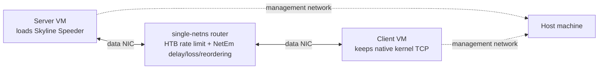

# Skyline Speeder Performance Validation Report

**This report presents validation results for a single build only; every result in it comes from the
build fingerprint (BPF object SHA-256) listed in Appendix A.** It is not the source of any conclusion
other than the performance comparison — it does not assess fairness, does not sweep coefficients
exhaustively, and is not a "complete" matrix in the sense of grid density. It answers one question
only: how this build performs relative to the kernel's default BBR in the target deployment
environment and in the guardrail scenarios. The neutrality of the all-modules-off path is a
correctness check, not a performance comparison, and is not in this report; see section 4 of
`docs/03-design.md`.

> **This report does not measure the current shipped default coefficients.** Throughout,
> `skyline-best` uses the defaults at the time the report was measured (listed in section 3.4), which
> are now kept in `docs/usage.md` under the name "high random loss" preset; the experiment matrix's own
> coefficient defaults (`research/experiments/matrix_lib.py`) are also pinned to this set, so this
> report remains reproducible. The current shipped defaults are a different set, tuned later on
> production deployments (see section 12 of `docs/03-design.md`); **they have not been rerun on this
> test-bed matrix, and none of the numbers in this report apply to them**.

## 1. Summary and main conclusions

1. **On the full 9-point grid of the target environment, `skyline-best` outperforms the default BBR**
   (section 4.1), in every case far beyond the acceptance criterion of "a lead of at least 5%".
2. **`reorder-dsack` (outside the target environment) is the only scenario where Skyline Speeder does
   worse than BBR** (section 5, about 13% below BBR); the gap is explicitly not a tuning target.
3. **The self-protective slowdown of the queue-delay/ECN guardrail (`guardrail_gain=0.8`) has a limited
   cost**: compared with the control configuration `guardrail_gain=0.0` (clamped to a neutral 1.0, no
   active slowdown), the throughput difference across the seven scenarios is between 0 and -3.7%, which
   is the expected cost of a self-protective slowdown (section 6.1; the `guardrail_hits` for
   `intercontinental-clean` use the combined pre-0.5.0 accounting, are mainly counts of cwnd hitting its
   cap, and do not show that the guardrail fires often there).
4. **M1 tier-2 (RTO floor and ceiling) has direct measured evidence**: the configuration with tier-2 on
   survived 3/3 runs in the forced-RTO scenario, with `max_rto_ms` at 902-1129ms; the control with
   tier-2 off survived only 1/3, and plain kernel-default BBR was once measured with its RTO pushed to
   about 101 seconds, close to the kernel's 120-second default ceiling (section 6.2). The sample is
   `n=3`, and the control toggles the whole of tier-2, so the result cannot be attributed to the
   ceiling alone.
5. **In the link-fluctuation scenario both Skyline Speeder variants still outperform the default BBR**
   (section 6.3), but the run-to-run coefficient of variation of throughput is markedly higher than in
   the static scenarios, and correlates with the fluctuation in the "congestion-evidence trigger
   count".
6. **DSCP marking of retransmitted packets works correctly over both IPv4 and IPv6, with zero
   mismarks** (section 6.4).
7. **Kernel version compatibility**: support is verified for 6.12 LTS and later; `6.1.x`/`6.6.x` are
   explicitly unsupported because of a difference in the kernel's struct_ops interface signature
   (section 7).

## 2. Test environment and validity bounds

### 2.1 Test-bed topology

Two 4-vCPU KVM guests + a single-netns router; the Server side loads Skyline Speeder, the Client side
keeps native kernel TCP, and the whole thing is fully transparent to the client.

### 2.2 Build under test

See Appendix A for the full build fingerprint table. The target-environment, guardrail and mechanism
validation data in sections 4-6 come from one and the same build; the DSCP marking validation in
section 6.4 and the kernel compatibility validation in section 7 each used a separate build
(byte-identical BPF source, differing only in the target kernel compiled for), with the fingerprints
listed in the corresponding subsections.

Before publication, a small additional re-check (`n=2`) was run with the latest build at the time (the
state of the code when this document was published) on a representative scenario of the target
environment (`rtt200-loss15`): the two re-check values of the non-accelerating neutral control
(`b2-skyline-base`, all modules off) were almost exactly the same as in the original main run — this
control's values for that scenario are not in this report's tables, and the raw run data does not ship
with the report (see Appendix A), so on this point the report cannot let readers check for themselves;
the `skyline-best` re-check values were about 6.5% below the main data in section 4.1, and the
confidence intervals of the two groups do not overlap. Checks confirmed that `skyline_cc.bpf.c` (the
congestion-control decision code itself) was byte-for-byte unchanged between the two builds, and the
non-accelerating control agreed closely between the two runs, so the difference is judged more likely
to be run-to-run noise at a small sample size (`n=2`) than a real regression caused by a code change —
but without data from a larger sample, a small real difference cannot be completely ruled out. The
build and scenario used for this re-check are in Appendix A.

### 2.3 Validity bounds

- **Upper end of the bandwidth axis**: only `offload=off` produces truly independent per-packet random
  loss (otherwise NetEm aggregates loss into occasional whole-frame drops, distorting the loss model),
  and this pushes the test bed's throughput ceiling down to about 100-150 Mbit/s; the
  target-environment scenarios all use `rate_mbit=100`. "Hundreds of Mbps" is a declared
  extrapolation, not directly validated on the test bed.
- **BBR cannot be tuned**: every internal parameter of the BBRv1 implementation in this kernel build is
  a compile-time constant, with no runtime tuning interface at all; the comparison target throughout
  this report is `bbr-fq` in its default configuration.
- **Loss and reordering in the out-of-target scenarios happen per large GSO frame**: the scenarios of
  section 3.2 (the data in sections 5 and 6.1) run with `offload=on` (most at 500/1000 Mbit, which the
  test bed can only reach this way), so the Server's large TSO frames reach the router intact, and what
  NetEm drops or reorders each time is a whole large frame, not a single packet. In a replica built
  with the same topology on a 6.12 host (sender → NetEm on a netns router → receiver), 0.5% NetEm
  random loss dropped 8.4 segments on average each time, with only about one seventh as many loss
  events as configured; with offload turned off on the sender, each drop was exactly 1 segment. In
  these scenarios every profile faces the same loss process, so their use for showing "no regression"
  is unaffected, but their numbers cannot be quoted as performance under the per-packet random loss
  written in the tables.
- **With `offload=off` the TC hook still sees `gso_segs>1` (cause identified)**: whatever the NIC's
  offload settings, TCP first builds large GSO frames — `sk_setup_caps()` (`net/core/sock.c`) adds
  `NETIF_F_GSO` to every TCP socket — and they are segmented in software only after leaving the qdisc,
  on the way to the NIC (`validate_xmit_skb()`). So the Server's own TC hook and qdisc see large frames,
  while what the NIC sends, what packet captures show, and what reaches NetEm on the router are all
  MTU-sized packets. NetEm sits on a separate device, the router, and with `offload=off` it drops per
  packet: in the replica above each drop corresponded to exactly 1 segment; the same NetEm placed on the
  sender's own egress still drops 3-4 segments per loss with `offload=off`. The per-packet random loss
  of the target-environment grid therefore holds.

### 2.4 Acceptance criteria definitions

**Primary criterion**: `median(skyline-best) ≥ 1.05 × median(bbr-fq)`.

**Robustness criterion**: `min_over_runs(skyline-best) > max_over_runs(bbr-fq, every run)` — BBR is
bimodal in some scenarios, so with small samples its median is an unstable threshold; instead the
criterion is "Skyline Speeder's minimum is still greater than the maximum of any single run of the
other side", which is not affected by sampling luck.

Points that fail are recorded as they are: nothing is hidden, and nothing is rerun to cherry-pick data
so that some item passes.

## 3. Scenario and Profile definitions

### 3.1 Target-environment scenario grid

`rtt_ms ∈ {100,200,300} × loss_pct ∈ {10,15,20}%`, all with `rate_mbit=100`, `queue_bdp=1.0`,
`loss_model="random"` and `offload="off"`: 9 scenarios in total, with IDs of the form
`rtt200-loss15`.

Bandwidth-sensitivity scenarios: the same `rtt200-loss15`, with `rate_mbit` at five points:
10/20/30/60/100.

### 3.2 Out-of-target guardrail scenarios

The following scenarios are outside the target deployment environment. They are used only to confirm
that nothing regresses in non-target scenarios, and are not tuning targets:

| Scenario ID | rtt_ms | rate_mbit | Loss | Reordering | Role |
|---|---:|---:|---|---|---|
| `line-rate` | 20 | 1000 | 0% | — | Lossless high speed; neutrality gate for the all-modules-off path (see section 4 of `docs/03-design.md`) |
| `light-loss` | 80 | 500 | 0.1% random | — | Light random loss |
| `primary` | 150 | 500 | 0.5% random | — | Medium distance, medium loss |
| `heavy-loss` | 250 | 100 | 2.0% random | — | Heavy loss |
| `burst-loss` | 150 | 500 | 0.5% gemodel, burst length 5 | — | Burst (clustered) loss |
| `reorder-dsack` | 100 | 500 | 0% | 25%, correlation 25% | Pure reordering |
| `intercontinental-clean` | 400 | 1000 | 0% | — | Lossless intercontinental control |

All of these scenarios use `offload=on`: the loss and reordering in the table happen per large GSO
frame, not per packet; see section 2.3.

### 3.3 Link-fluctuation scenario

The router's NetEm/HTB parameters are hot-updated live within a single case (`tc ... change`, without
interrupting connections or zeroing the qdisc counters): `volatile-bandwidth-cliff` (`rtt_ms=300`,
with gemodel burst loss throughout, burst length 220) has four segments — `[0,20)s` steady at
`rate=100Mbit` with 0.5% loss; `[20,35)s` a sudden drop to `rate=15Mbit` (queue length in packets held
fixed, so the queueing delay really grows), loss still 0.5%; `[35,43)s` at the same low bandwidth,
loss rises to 8%, a real loss burst; `[43,59)s` back to `rate=100Mbit` with 0.5% loss. (The manifest's
comment says `[20,35)s` introduces no loss, but its configuration, that is, the condition actually
run, is 0.5%.)

### 3.4 Profile definitions

| Profile ID | `cc` | Description |
|---|---|---|
| `bbr-fq` | `bbr` | Industry-standard baseline |
| `b2-skyline-base` | `skyline_cc` | The Skyline Speeder framework with all four optional modules off; the neutral baseline (neutrality validation in section 4 of `docs/03-design.md`) |
| `skyline-best` | `skyline_cc` | All modules on, with the default coefficients at the time the report was measured: `cruise_inflight_gain` 2.0 / `cruise_pacing_gain` 1.1 / `loss_inflation_max_ratio` 0.5 / guardrail 100ms·1.0× / `min_rtt_window_s` 10 / `bw_window_rtts` 10 / STARTUP exit 3 rounds·25% (**not** the current shipped defaults; see the note at the top) |

The experiment manifests (`research/experiments/manifests/`) also define baseline profiles for other
kernel-native algorithms; this report compares only with `bbr-fq` and does not list them.

Below are control variants of `skyline-best`, used to isolate the effect of one setting
(`skyline-guardrail-neutral` and `skyline-relaxed-congestion-ratio` change only one coefficient;
`skyline-rto-baseline` removes the whole `[rack_rto]` section):

| Profile ID | Difference from `skyline-best` |
|---|---|
| `skyline-guardrail-neutral` | `guardrail_gain=0.0` (the guardrail only cancels acceleration and does not actively slow down) |
| `skyline-rto-baseline` | Omits `[rack_rto]` entirely: the experiment harness therefore sends `ssctl reset-rack-rto`, returning to the guest configuration's "off", so neither half of M1 tier-2, floor or ceiling, takes effect (`skyline-best` has both halves on: floor `srtt_permille` 1100, `floor_us` 20000; ceiling 3x/6x) |
| `skyline-relaxed-congestion-ratio` | `rto_max_congestion_ratio_permille=1500` (the congestion-evidence threshold relaxed from the default 2x to 1.5x) |

Why `cruise_inflight_gain` (2.0) / `cruise_pacing_gain` (1.1) were chosen: the cwnd gain is
deliberately looser than the pacing gain (cwnd only needs not to be the limiting factor; the real rate
limiter is pacing), and the exact values were chosen on the target-environment grid by weighing
throughput against the risk of self-harm; the full explanation of the coefficients is in section 12 of
`docs/03-design.md`.

## 4. Target-environment results

### 4.1 9-point grid

(Unit Mbit/s, `n=2`, `median`/`min`)

| Scenario | bbr median | bbr min | skyline median | skyline min | vs bbr |
|---|---:|---:|---:|---:|---:|
| `rtt100-loss10` | 84.28 | 84.14 | 95.36 | 94.75 | 113% |
| `rtt100-loss15` | 79.61 | 79.10 | 95.74 | 95.00 | 120% |
| `rtt100-loss20` | 3.54 | 1.38 | 94.92 | 94.71 | 2678% |
| `rtt200-loss10` | 76.86 | 73.90 | 94.88 | 93.49 | 123% |
| `rtt200-loss15` | 30.89 | 19.04 | 95.04 | 91.81 | 308% |
| `rtt200-loss20` | 21.16 | 0.46 | 95.13 | 93.28 | 450% |
| `rtt300-loss10` | 80.66 | 79.57 | 90.24 | 89.84 | 112% |
| `rtt300-loss15` | 10.88 | 10.11 | 79.44 | 74.91 | 730% |
| `rtt300-loss20` | 3.48 | 3.10 | 79.92 | 77.43 | 2296% |

**All 9/9 points pass both the primary criterion and the robustness criterion.**

### 4.2 More samples at the high-RTT end (`n=5`)

Additional samples for the three highest-RTT points of the target environment, to tighten the
confidence intervals:

| Scenario | skyline median (`n=5`) | bbr median | Ratio | skyline min | bbr max (any run) | Robustness | skyline CV% |
|---|---:|---:|---:|---:|---:|---|---:|
| `rtt300-loss10` | 90.01 | 81.41 | 1.11x | 88.46 | 82.63 | Pass | 3.2% |
| `rtt300-loss15` | 83.80 | 4.32 (median)/75.46 (best single run) | 19.4x | 80.61 | 75.46 | Pass | 3.7% |
| `rtt300-loss20` | 75.75 | 2.06 (median)/48.23 (best single run) | 36.9x | 73.57 | 48.23 | Pass | 2.6% |

BBR's median at `rtt300-loss15`/`-loss20` is far below its best single run, a direct sign of BBR's
bimodal distribution at these two points; even under the more conservative robustness criterion of
"compare with BBR's best single run ever", Skyline Speeder passes at every point. At `n=5`, Skyline
Speeder's own CV is within 4% everywhere.

### 4.3 Bandwidth sensitivity

(`rtt200-loss15`, five `rate_mbit` points, unit Mbit/s)

| Bandwidth | bbr median (range) | skyline median (range) |
|---:|---:|---:|
| 10 Mbit | 4.3 (0.8-7.8) | **9.4** (9.26-9.47) |
| 20 Mbit | 15.6 (15.5-15.7) | **18.6** (18.0-19.2) |
| 30 Mbit | 6.5 (2.7-10.4) | **28.3** (28.2-28.4) |
| 60 Mbit | 5.9 (2.7-9.2) | **56.5** (55.7-57.3) |
| 100 Mbit | 76.9 (75.7-78.1) | **95.7** (95.7-95.8) |

Skyline Speeder consistently beats BBR at all 5 bandwidth points, with far less variance than BBR (BBR
is bimodal at the three points 10/30/60 Mbit, and single runs can differ by a factor of 3-4). At the
low end, 10/20 Mbit, Skyline Speeder undershoots slightly (2-10% below the nominal bandwidth; at
bandwidths this low `initial_cwnd_packets=100` already exceeds the BDP); this known small limitation is
recorded as it is.

## 5. Regression guardrail in out-of-target scenarios

The following scenarios are outside the target deployment environment and are used only to confirm
that nothing regresses in non-target scenarios:

(`n=3`, median, unit Mbit/s)

| Scenario | bbr | skyline-best |
|---|---:|---:|
| `intercontinental-clean` | 432.50 | 884.34 |
| `line-rate` | 935.09 | 956.41 |
| `light-loss` | 466.58 | 477.95 |
| `primary` | 452.04 | 463.37 |
| `heavy-loss` | 88.60 | 93.85 |
| `burst-loss` | 458.86 | 467.49 |
| `reorder-dsack` | 459.77 | 397.76 |

**`reorder-dsack` is the only scenario where Skyline Speeder does worse than BBR** (about 13% below
BBR) — it is a pure-reordering scenario outside the target environment; it is recorded as it is and is
not a tuning target. In every other scenario Skyline Speeder outperforms or matches BBR.

## 6. Mechanism-level validation

### 6.1 Self-protective slowdown of the queue-delay/ECN guardrail

**Mechanism**: when the guardrail fires (queueing delay above the threshold, or a fresh ECN CE mark),
both the cwnd target gain and the pacing gain for that round are clamped to `guardrail_gain` (default
0.8: pacing drops to 80% of the measured bandwidth; the cwnd target is afterwards still multiplied by
M3's loss-compensation factor, see section 6 of `docs/03-design.md`); `0.0` means only cancelling
acceleration, without actively slowing down. The decision is made afresh every round; it is not a
sticky state.

**Validation** (`{skyline-best, skyline-guardrail-neutral}` × 7 scenarios that historically triggered
it often × `n=3`, unit Mbit/s, median):

| Scenario | skyline-best | skyline-guardrail-neutral | Difference | guardrail_hits (sum of the 3 runs, best/neutral, combined pre-0.5.0 accounting) |
|---|---:|---:|---:|---:|
| `intercontinental-clean` | 884.34 | 884.35 | <0.01% | 207811 / 207907 |
| `line-rate` | 956.41 | 956.41 | 0% | 4 / 11 |
| `light-loss` | 477.95 | 478.22 | -0.06% | 14 / 29 |
| `primary` | 463.37 | 480.53 | -3.6% | 28 / 17 |
| `heavy-loss` | 93.85 | 95.56 | -1.8% | 11 / 14 |
| `burst-loss` | 467.49 | 478.22 | -2.2% | 35 / 27 |
| `reorder-dsack` | 397.76 | 413.24 | -3.7% | 84 / 95 |

Almost none of the 208,000 `guardrail_hits` in `intercontinental-clean` are guardrail firings: when
this data was collected, the counter was still incremented on **every ACK** while cwnd sat at
`max_cwnd_packets` (from 0.5.0 this part is counted separately in `cwnd_cap_hits`, and guardrail
firings are counted per round in `guardrail_hits`; see section 4 of
`docs/02-interface-reference.md`). The BDP of 400 ms × 1000 Mbit/s is about 35,000 packets; multiplied
by the inflight gain of 2.0 it exceeds the cap of 50,000 packets, so cwnd stays pinned at the cap. The
queue-delay/ECN guardrail, on the other hand, counts at most once per round: a 45-second case has fewer
than 115 rounds per run, so at most about 340 over the 3 runs combined. The two profiles differ by
<0.01%: this flow is held near full speed by the cwnd cap and the link bandwidth, the guardrail gain has
almost no chance to act, and this row does not show that the guardrail fires often. The small drops in
the other scenarios (2-4%) are the expected cost of the "self-protective slowdown" design itself when
the guardrail really takes effect (trading a little throughput for a queueing-delay/ECN safety margin),
not a defect.

### 6.2 M1 tier-2: `TCP_RTO_MAX_MS` ceiling adjustment

**Mechanism**: `ceiling = clamp(k × base_rtt, 1000ms, 120000ms)`; without congestion evidence
`k=rto_max_normal_permille` (3x in this experiment's configuration), and once real congestion evidence
is detected (a fresh CE mark, or srtt growing clearly relative to min_rtt) it switches to
`rto_max_congested_permille` (6x in this experiment's configuration), without falling back to the
kernel's 120-second default. In the code and the bundled templates both default to 0, that is, the
ceiling is off; this option needs kernel ≥ 6.15 (this report used 6.18.40).

**Measured in the forced-timeout scenario** (`forced-rto-burst-rtt300`: `rtt_ms=300`,
`rate_mbit=15`, 8% Gilbert-Elliott burst loss):

| profile | Valid/total | `rack_rto_max_applied` (per run) | `rack_rto_max_rejected` | `max_rto_ms` (per run) |
|---|---:|---:|---:|---:|
| `skyline-best` (ceiling on) | 3/3 | 12-15 | 0 | 902 / 1086 / 1129 |
| `skyline-rto-baseline` (tier-2 off) | 1/3 | — | — | 902 (the only valid sample) |
| `bbr-fq` (no Skyline Speeder, kernel native) | 3/3 | — | — | 902 / 4016 / **100992** |

The 3 valid samples of `skyline-best` have `max_rto_ms` of 902-1129ms, with `rack_rto_max_rejected` 0
in every one (the mechanism was invoked and the kernel accepted it). By the formula, the ceiling is
`clamp(3 × base_rtt, 1000ms, 120000ms)`: at an RTT of 300ms it is at least 1000ms, and larger when
queueing pushes srtt up or congestion evidence appears, so a maximum such as 902ms did not itself touch
the ceiling (the two groups without a ceiling also each had one 902ms). For the control `bbr-fq` (no
Skyline Speeder at all, pure kernel default behaviour), `max_rto_ms` varied enormously across the three
runs, and one of them sampled **100992ms** (about 101 seconds, approaching the kernel's `TCP_RTO_MAX`
default ceiling of 120 seconds); `skyline-rto-baseline` (tier-2 entirely off, neither ceiling nor
floor) had a valid rate of only 33% in this scenario — most runs were dragged straight into the
kernel's default cascading timeouts and were marked invalid early by the timeout protection. What
`n=3` can support is "none of the 3 runs with tier-2 on had an RTO of several seconds"; this control
toggles the whole of tier-2 (floor and ceiling), so the difference in survival rate cannot be
attributed to the ceiling alone.

**The congestion-evidence branch in the link-fluctuation scenario** (`volatile-bandwidth-cliff`,
`n=3`):

| profile | `rack_rto_max_applied` (per run) | `rack_rto_max_rejected` | `rack_rto_max_congested` (per run) | `max_rto_ms` (per run) |
|---|---|---:|---|---|
| `skyline-best` (threshold 2x, the default) | 21 / 22 / 10 | 0 / 0 / 0 | 2 / 2 / 0 | 4812 / 3677 / 1359 |
| `skyline-relaxed-congestion-ratio` (threshold 1.5x) | 22 / 18 / 20 | 0 / 0 / 0 | 11 / 13 / 14 | 3850 / 4334 / 2559 |

`rack_rto_max_applied>0` and `rack_rto_max_rejected==0` hold in all 6 cases. With the
congestion-evidence threshold relaxed from the default 2x to 1.5x, the number of
`rack_rto_max_congested` triggers jumped from about 1.3 per run on average to about 12.7 per run, an
order-of-magnitude difference that holds consistently across 3 independent runs, confirming that the
threshold itself is the main factor limiting how often this branch fires. `max_rto_ms` is generally
far above the nominal 900/1800ms computed from the nominal `base_rtt=300ms` — this is expected: the
`base_rtt` in the ceiling formula is itself genuinely pushed up to the order of several seconds during
the drop-plus-loss window, and the 6x multiplies this already inflated base, not the nominal 300ms.

**One point still not directly confirmed**: the `rack_rto_max_congested` counter increments on every
RTT callback in which the evidence holds, and has no direct event-by-event correspondence with
"whether an RTO timeout actually occurred" — the existing data confirm that "the overall frequency with
which the evidence holds" and "the measured `max_rto_ms`" move in the same direction, but they are not
event-level direct evidence of the kind "when one specific RTO timeout occurred, the ceiling really
used 6x and not 3x".

### 6.3 Overall performance in the link-fluctuation scenario

(`volatile-bandwidth-cliff`, whole-case throughput, `n=3`, median, unit Mbit/s — this is the number
averaged over all four segments of the run combined):

| profile | Median | CV | vs bbr |
|---|---:|---:|---:|
| `bbr-fq` | 51.92 | 5.1% | — |
| `skyline-best` | 54.43 | 36.1% | +4.8% |
| `skyline-relaxed-congestion-ratio` | 57.79 | 2.2% | +11.3% |

Both Skyline Speeder variants still outperform BBR, but `skyline-best`'s own run-to-run coefficient of
variation reaches 36.1%, moving in the same direction as the fluctuation in the congestion-evidence
trigger count (the run with 0 triggers had a `max_rto_ms` of only 1359ms, the two runs with 2 triggers
reached 3677-4812ms, and throughput fluctuated with them) — `n=3` is not enough to quantify the
relationship between the two, so the correlation can only be pointed out as it is.
`skyline-relaxed-congestion-ratio` (CV only 2.2%) is more stable and has higher throughput in this
fluctuating scenario; whether the default threshold should be lowered is a direction worth validating
later with larger samples, and this report does not change the default directly.

**Measurement limitation of per-segment throughput**: splitting iperf3's 0.5-second sampling windows at
the segment time boundaries showed a wide gap between the per-segment mean and median for the Skyline
Speeder profiles (Skyline Speeder's paced sending is itself bursty: a 0.5-second window often falls
entirely between two bursts and reports 0, and occasionally a window catches the resend burst after a
real RTO and reports an instantaneous value far above the rate limit) — this is a real characteristic
of the sending pattern, not a problem in the statistics code, but it means the per-segment mean
throughput cannot be taken at face value for the Skyline Speeder profiles; only the median can be used
as a reference. The whole-case throughput in this section 6.3 (from iperf3's own whole-run summary) is
not affected by this problem, and is the only throughput metric this report accepts for the
link-fluctuation scenario.

### 6.4 DSCP marking of retransmitted packets (IPv4/IPv6)

**Mechanism**: `skyline_tc.bpf.c` detects retransmitted TCP segments on the egress of the sending NIC
(comparing the packet's own sequence number with `bpf_tcp_sock(sk)->snd_nxt`), and on a match sets the
configured DSCP code point. It is attached at the interface level, regardless of cgroup, and applies
uniformly to every TCP flow on that interface, whichever congestion control algorithm the flow uses.

**Validation** (checked against real packet captures; `retransmit_capture_marked` = number of
retransmitted segments the capture confirms as marked, `retransmit_capture_false_positives` = number of
non-retransmitted segments marked by mistake):

| Address family | Scenario mix | Profiles covered | Marks confirmed by capture | Mismarks |
|---|---|---|---:|---:|
| IPv4 | Scenarios with a loss mechanism + zero-loss control | Kernel-native algorithm baselines (`bbr-fq` etc., including DSCP-off / custom-code-point controls) / `skyline-best` | About 50,000 in total | **0** |
| IPv6 | Same as above (v6 extension-header parsing path) | Same as above | About 47,000 in total | **0** |

**All 12 IPv4 cases + 12 IPv6 cases are valid, with zero mismarks.** With DSCP off
(`bbr-fq-dscp-off`) the mark count is always 0, confirming that the switch itself works correctly; with
a different DSCP code point (`bbr-fq-dscp46`) the marking behaves the same, confirming that the code
point is purely a configurable placeholder parameter and does not affect the marking mechanism itself.
The IPv6 path's extension-header walk (bounded unrolling; fragment headers, authentication headers and
unknown extension headers are all passed through unprocessed) produced no mismarks in this validation.

## 7. Kernel version compatibility

Compatibility smoke validation was run on five kernel versions, `6.1.180`/`6.6.148`/`6.12.101`/`6.18.42`/`7.1.6`
(mainly for correctness/compatibility, not to the performance-validation standard of the preceding
sections of this report):

| Version | Result |
|---|---|
| `6.1.180` | Unsupported — see the root cause below |
| `6.6.148` | Unsupported — see the root cause below |
| `6.12.101` | Pass, including an IPv4/IPv6 data-plane smoke test |
| `6.18.42` | Pass, including an IPv4/IPv6 data-plane smoke test |
| `7.1.6` | Pass, including an IPv4/IPv6 data-plane smoke test |

**Root cause (verified against a local kernel source tree + upstream kernel tags, not a guess)**: the
callback that `skyline_cc.bpf.c` attaches to `struct tcp_congestion_ops.cong_control` is declared with
4 parameters (`sk, ack, flag, rs`). The kernel only started using this signature in version 6.10 — in
6.9 and earlier the `cong_control` function-pointer type has only 2 parameters (`sk, rs`), and the BPF
verifier rejects the program outright at load time, with an error that points clearly at the
mismatched parameter count. `6.1.x`/`6.6.x` both predate this version boundary. `skyline_tc`
(retransmission DSCP marking) and `skyline_policy` (M1 tier-2 dynamic RTO) do not touch
`cong_control` and are unaffected.

**Supported range**: the exact ABI floor is kernel 6.10 (inclusive) and later; `6.10`/`6.11` satisfy
the ABI but are not LTS and have too short a support period, so relying on them is not recommended; the
verified and committed floor of support is **6.12 LTS**.

## 8. Limitations and what is not covered

- **Not responding to loss at all has a cost**: on a real **congestion-type** bottleneck (as opposed to
  random loss), Skyline Speeder keeps pushing, harms itself and affects other flows on the same path;
  the queue-delay/ECN guardrail (including the self-protective slowdown of section 6.1) is the only
  means of self-protection, which is enough within the target environment (mainly random loss) but is
  not a general safety net. Before deploying, assess whether the loss on the target link really is
  mainly random loss.
- **Bandwidth validated only up to 100 Mbit/s**: `offload=off` is a structural ceiling of the test bed;
  "hundreds of Mbps" is an extrapolation, not directly measured.
- **Fairness was not measured, and is explicitly not a goal of this report**.
- **BBR still leads slightly in the `reorder-dsack` scenario**; this scenario is outside the target
  environment and is not a tuning target.
- **BBR cannot be tuned**: the BBRv1 in this kernel build has no runtime tuning interface at all; the
  comparison target is always BBR in its default configuration.
- **Structural limit of the M1 tier-2 floor adjustment on high-RTT links**: the target value of
  `TCP_BPF_RTO_MIN` is constrained by the kernel's `TCP_RTO_MIN` (200ms); this limit does not affect the
  ceiling adjustment (the two are independent mechanisms).
- **The specific values of `guardrail_gain`/`rto_max` have not been validated with a matrix comparing
  candidates**: the validation confirmed that once really active, both act in the right direction and
  introduce no regression, but the three numbers 0.8/3x/6x themselves are still initial values chosen
  directly.
- **The event-by-event coincidence of the "congestion evidence" branch of M1 tier-2 `rto_max` with real
  RTO timeouts is still not directly confirmed** (see section 6.2) — the existing data are correlational
  evidence at the level of whole-case counters/whole-case maxima, not event-level direct evidence.
- **Per-segment mean throughput in the link-fluctuation scenario is unreliable for the Skyline Speeder
  profiles** (see section 6.3); only the median can be used, and the number of samples per segment is
  not large (16-30).
- **Single test bed**: all results come from a single KVM test bed (two 4-vCPU guests + a single-netns
  router) and have not been reproduced on different hardware or virtualization setups.
- **Loss model of the out-of-target scenarios**: the scenarios of section 3.2 run with `offload=on`, so
  loss and reordering happen per large GSO frame and are more clustered than the tables say (see
  section 2.3). The `offload=off` used by the target-environment grid gives per-packet loss; the reason
  the TC hook sees `gso_segs>1` there has been identified, also in section 2.3.

## Appendix A: Data sources and build fingerprints

| Section | Data source (manifest) | Kernel version | `skyline_cc.bpf.o` SHA-256 (first 12 characters) |
|---|---|---|---|
| Sections 4/5/6.1/6.2/6.3 | Target-environment grid, bandwidth sensitivity, guardrail A/B, RTO ceiling validation, link fluctuation | 6.18.40 | `1cb1d581c4f7` |
| Section 6.4 (IPv4) | Retransmission DSCP mechanism validation (v4) | 6.18.40 | Separate build; see `environment.json` in the run directory |
| Section 6.4 (IPv6) | Retransmission DSCP mechanism validation (v6) | 6.18.40 | Separate build; see `environment.json` in the run directory |
| Section 7 | 5-version kernel compatibility smoke test | See the table | A separate build per version; see each one's run directory |
| Pre-publication re-check (section 2.2) | Latest build at the time, `rtt200-loss15` (the scenario reported in section 2.2), `n=2` | 6.18.40 | Build of the then-current HEAD |

The full raw run data (`runs.csv`/`summary.csv`/per-case details) does not ship with this report; for
how to reproduce it, see `research/experiments/README.md`.
